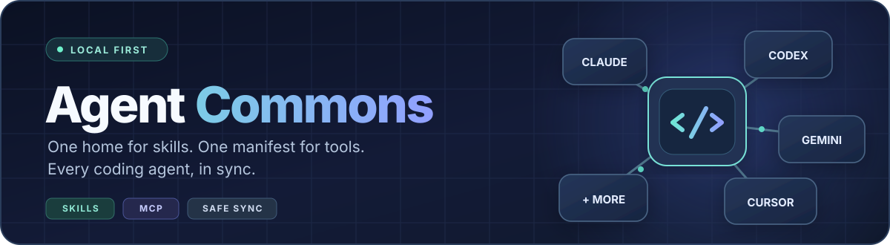

<div align="center">

[🇫🇷 Français](README.md) · **🇬🇧 English**



[](https://github.com/neosoda/agent-commons/actions/workflows/ci.yml)
[](https://github.com/neosoda/agent-commons/releases)
[](https://nodejs.org)
[](LICENSE)

**One shared configuration for AI agents, without giving up control.**

</div>

Agent Commons centralizes your **skills**, **MCP** servers and synchronization for Codex, Claude Code, Gemini CLI, Antigravity, OpenCode and other clients. A local interface, discoverable catalog, previewed operations and backups make repetitive setup unnecessary.

**Verified baseline, November 28, 2026:** 21 recognized AI environments, 212 skill **references**, 11 MCP **references** (including XERJ and Sellbird). Catalog entries are not installed packages. All 11 required GitHub checks (6 OS/Node, 3 live XERJ, Chromium and Windows portable) succeeded on `main` `2570fabf`, published as [v0.6.1](https://github.com/neosoda/agent-commons/releases/tag/v0.6.1).

> **Release status:** [v0.6.1](https://github.com/neosoda/agent-commons/releases/tag/v0.6.1) ships the Windows 8.3 security fix and the **experimental mission runtime** from `main` (`2570fabf`). The mission runtime remains **experimental** (no strong OS sandbox and no completed LM Studio/RTX hardware acceptance); the Windows portable ZIP is **unsigned**, and no npm publication is claimed. See [capabilities and evidence](docs/CAPABILITIES.md).

## Install

**Portable Windows:** download the [latest GitHub release](https://github.com/neosoda/agent-commons/releases/latest), verify the `.sha256` checksum, extract the entire ZIP and run `AgentCommonsPortable/Start-AgentCommons.cmd`. The portable archive does not require a separate Node.js installation.

**From source:** Node.js >=22, npm and Git.

```bash
git clone https://github.com/neosoda/agent-commons.git
cd agent-commons
npm ci
npm run build
node dist/cli/index.js doctor
node dist/cli/index.js sync --dry-run
# Only after reviewing the plan:
node dist/cli/index.js backup
node dist/cli/index.js sync
# Local UI (127.0.0.1 only)
node dist/cli/index.js web
```

Try with `--home <test-directory>` first to avoid affecting your regular profile. `doctor` does not start MCP servers; `mcp probe` performs an **explicit live** test. The `@neosoda/agent-commons` npm publication is **not independently verified**: use source or GitHub releases until its registry listing is confirmed.

## Optional Sellbird integration

[Sellbird](https://github.com/ethanplusai/sellbird) v0.5.0 is a manual external MCP reference (AGPL-3.0), with a dedicated `outreach` profile. Separate installation, explicit sync, status and draft preparation; Agent Commons does not enable sending or autopilot. [Setup and security](docs/SELLBIRD.md).

## Optional local XERJ search

**XERJ v1.0.0-rc.104** is available through the existing Extension Manager and MCP Control Center: official SHA-256 verified installation, existing executable detection, local node controls, explicit indexed roots, search and per-client MCP sync. Browsing does not install or run anything; SQLite memory is not replaced. Query-1 and Reader-1 are **not** bundled. **[XERJ setup and Codex/Claude workflow](docs/XERJ.md).**

## What it does

- **Configure clients:** detect native formats, synchronize selected skills/MCP entries, manage profiles and restore snapshots.
- **Discover without context bloat:** search the catalog, rank metadata and load only the relevant `SKILL.md`. The complete skill catalog is not injected into a prompt.
- **Manage extensions:** install/update reviewed skills and selected pinned MCP packages through Extension Manager, then **configure and synchronize separately**. Installed does not imply callable.
- **Run local missions (experimental on `main`):** OpenAI-compatible LM Studio model, allowed tools, plans, per-repository SQLite FTS5 memory, persistent queue, worker and Mission Control. External AI CLIs can give **optional advice**, not execute delegated coding tasks in parallel.

```bash
# Selective skills metadata routing
node dist/cli/index.js skills route "audit UX of an application" --json
node dist/cli/index.js skills load ux-psychology

# Read-only mission on a trusted Git checkout, after starting LM Studio
node dist/runtime/cli.js --workspace "/path/to/repository" --task "Inspect this repository without making changes" --model "EXACT_LM_STUDIO_MODEL_ID"
```

**Security:** the unauthenticated Skill Hub is bound strictly to `127.0.0.1`; **never expose it directly to a LAN or the Internet**. Runtime file writes, repository tests, MCP calls and third-party installs require explicit relevant permissions. Strong OS sandboxing and full real LM Studio/RTX acceptance for the new runtime are still missing.


### Universal Loop Engineering

The original [Universal Product Engineering](skills/universal-product-engineering/SKILL.md) skill (V2) orchestrates bounded development, testing, content enrichment and anti-AI-slop UX/UI critique cycles with a measured baseline, scorecard, evidence hierarchy and checkpoints. After explicit installation and synchronization to the chosen client, ask: “Run the universal-product-engineering skill on the current project.” See the [operating guide](docs/SKILLS_AND_MCP.md#loop-engineering-universel).

## Documentation: find the right source quickly

| Need | Document |
|---|---|
| New agent or contributor | [AGENTS.md](AGENTS.md) → [operational handoff](PROJECT_HANDOFF.md) |
| Architecture and accepted decisions | [Architecture](docs/ARCHITECTURE.md) · [Decisions](docs/DECISIONS.md) |
| Available features, evidence and limitations | [Capabilities](docs/CAPABILITIES.md) |
| Skills, MCP, routing and permissions | [Skills & MCP](docs/SKILLS_AND_MCP.md) · [Extension Manager](docs/EXTENSION_MANAGER.md) |
| Run an autonomous mission | [Runtime](docs/AGENT_RUNTIME.md) |
| Safety and next priorities | [SECURITY.md](SECURITY.md) · [Roadmap](docs/ROADMAP.md) |
| Troubleshooting and QA | [Diagnostics](docs/DIAGNOSTICS.md) · [Windows acceptance](docs/qa/RELEASE_ACCEPTANCE.md) |
| Release history and old source documents | [Changelog](CHANGELOG.md) · [Archives](docs/archive/INDEX.md) |

Agent Commons remains **independent of SentinelBrain**: an external-PC model provider, distributing skills/MCP across a LAN, and shared services are **future integration ideas**, not a claimed deployment.

## Upstream credits and licenses

Agent Commons code is [MIT licensed](LICENSE). The catalog references third-party projects **without absorbing their licenses or claiming they are safe**. All authors, sources and declared licenses remain credited in the [full index](docs/skills/README.md). Project-specific integration guides are also available under `docs/`.

<!-- BEGIN GENERATED SKILL REPOSITORY CREDITS -->
The curated public catalog references **212 skills across 33 upstream repositories**. These are **metadata-only references**: Agent Commons does not bundle or automatically install their skills. Licenses are recorded per pinned skill in [the full index](docs/skills/README.md); repositories with more than one license must be checked per skill.

| Upstream repository | Author / maintainer | Skill references | Declared license(s) |
|:--|:--|--:|:--|
| [affaan-m/ECC](https://github.com/affaan-m/ECC) | Affaan Mustafa / ECC contributors | 71 | MIT |
| [AgricIDaniel/claude-seo](https://github.com/AgricIDaniel/claude-seo) | AgriciDaniel | 1 | MIT |
| [anthropics/skills](https://github.com/anthropics/skills) | Anthropic | 4 | Apache-2.0 |
| [cathrynlavery/diagram-design](https://github.com/cathrynlavery/diagram-design) | Cathryn Lavery | 1 | MIT |
| [cloudflare/security-audit-skill](https://github.com/cloudflare/security-audit-skill) | Cloudflare | 1 | MIT |
| [coreyhaines31/marketingskills](https://github.com/coreyhaines31/marketingskills) | Corey Haines | 1 | MIT |
| [DojoCodingLabs/remotion-superpowers](https://github.com/DojoCodingLabs/remotion-superpowers) | Dojo Coding Labs | 15 | MIT |
| [ecapri-dev/simulab-skill](https://github.com/ecapri-dev/simulab-skill) | ecapri-dev (@0xKapri) | 1 | MIT (bundled fonts: OFL-1.1) |
| [frankxai/awesome-hermes-agent-skills](https://github.com/frankxai/awesome-hermes-agent-skills) | Frank Riemer / GenCreator | 1 | MIT |
| [heygen-com/hyperframes](https://github.com/heygen-com/hyperframes) | HeyGen | 21 | Apache-2.0 |
| [Jakeschincariol/founder-skill](https://github.com/Jakeschincariol/founder-skill) | Jake Schincariol | 11 | MIT |
| [jmanico/grim-prompter](https://github.com/jmanico/grim-prompter) | Jim Manico / Manicode Security | 1 | MIT |
| [JuliusBrussee/caveman](https://github.com/JuliusBrussee/caveman) | JuliusBrussee | 22 | Apache-2.0 |
| [latent-spaces/brag](https://github.com/latent-spaces/brag) | latent-spaces | 1 | MIT |
| [lemomo-ai/lemo-opuscar](https://github.com/lemomo-ai/lemo-opuscar) | Lemomo / LemoLab | 1 | CC-BY-NC-4.0 (skill/docs); MIT (script) |
| [markoblogo/abvx-agent-skills](https://github.com/markoblogo/abvx-agent-skills) | Anton Biletskiy-Volokh | 4 | MIT |
| [mattpocock/skills](https://github.com/mattpocock/skills) | Matt Pocock | 5 | MIT |
| [morellid/ai-act-skill](https://github.com/morellid/ai-act-skill) | Davide Morelli | 1 | MIT |
| [neosoda/agent-commons](https://github.com/neosoda/agent-commons) | Agent Commons contributors | 2 | MIT |
| [nextlevelbuilder/ui-ux-pro-max-skill](https://github.com/nextlevelbuilder/ui-ux-pro-max-skill) | Next Level Builder | 7 | Apache-2.0 / MIT |
| [ninjasweb/video-engine-skill](https://github.com/ninjasweb/video-engine-skill) | ninjasweb | 1 | MIT |
| [noamdorr/saas-product-demo-video](https://github.com/noamdorr/saas-product-demo-video) | Noam Dorr | 1 | MIT |
| [nutlope/hallmark](https://github.com/nutlope/hallmark) | nutlope | 1 | MIT |
| [NVIDIA/SkillSpector](https://github.com/NVIDIA/SkillSpector) | NVIDIA | 1 | Apache-2.0 |
| [pbakaus/impeccable](https://github.com/pbakaus/impeccable) | pbakaus | 1 | Apache-2.0 |
| [shadcn/improve](https://github.com/shadcn/improve) | shadcn | 1 | MIT |
| [thedotmack/claude-mem](https://github.com/thedotmack/claude-mem) | thedotmack | 28 | Apache-2.0 |
| [vercel-labs/agent-desktop](https://github.com/vercel-labs/agent-desktop) | Vercel Labs | 1 | Apache-2.0 |
| [vercel-labs/skills](https://github.com/vercel-labs/skills) | Vercel | 1 | MIT |
| [viettranx/3dviz-pro-max](https://github.com/viettranx/3dviz-pro-max) | viettranx | 1 | MIT |
| [Vincentwei1021/video-shotcraft](https://github.com/Vincentwei1021/video-shotcraft) | Vincentwei1021 | 1 | Apache-2.0 |
| [wheresryan22/anatomy](https://github.com/wheresryan22/anatomy) | Ryan (wheresryan22) | 1 | MIT |
| [zeative/motion-educator](https://github.com/zeative/motion-educator) | Zeative | 1 | MIT |
<!-- END GENERATED SKILL REPOSITORY CREDITS -->

We also acknowledge [Model Context Protocol](https://github.com/modelcontextprotocol/servers), [Microsoft Playwright](https://github.com/microsoft/playwright-mcp), [Docker MCP Gateway](https://github.com/docker/mcp-gateway), [GitHub MCP Server](https://github.com/github/github-mcp-server), and the maintainers of the cataloged skills. Verify actual sources and approved versions before execution.

[Contributing](CONTRIBUTING.md) · [Security policy](SECURITY.md) · [Releases](https://github.com/neosoda/agent-commons/releases)
