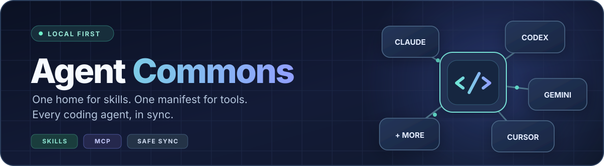

<div align="center">

[🇫🇷 Français](README.md) · **🇬🇧 English**



<br />

[](https://github.com/neosoda/agent-commons/actions/workflows/ci.yml)
[](https://github.com/neosoda/agent-commons/releases)
[](https://nodejs.org)
[](LICENSE)
[](#compatibility)

**The local-first home for your AI coding agents.**  
Share skills, keep MCP configurations in sync, and protect existing setups.

[**Get started**](#quick-start) · [How it works](#how-it-works) · [Compatibility](#compatibility) · [Safety](#designed-to-be-safe) · [Credits](#credits-and-upstream-projects) · [Contribute](CONTRIBUTING.md)

</div>

---

## Stop configuring the same thing seventeen times.

Claude Code, Codex, Cursor, Gemini, OpenCode and other coding agents all want their own skills and tools. Agent Commons gives them **a shared source of truth**—without forcing you to abandon their native configurations.

| 🧩 **One skills library** | 🔌 **One MCP manifest** | 🛟 **A way back** |
|:--|:--|:--|
| Reuse the same `SKILL.md` folders through filesystem links—no needless copies. | Add shared servers to each supported agent's native JSON, JSONC or TOML configuration. | Preview changes, keep conflicts intact, capture snapshots and restore previous state. |

**At a glance:** 17 registered agent environments · 9 with Skills + MCP adapters · 8 with Skills synchronization · Windows, macOS and Linux CI.

> [!NOTE]
> **Distribution:** See [GitHub Releases](https://github.com/neosoda/agent-commons/releases) for the latest published version and Windows portable assets. The optional npm package is available only after [its first verified registry publication](https://www.npmjs.com/package/@neosoda/agent-commons); if npm has not published it yet, use the source instructions below. Never assume `npx @neosoda/agent-commons` works until the registry confirms the version.

## Getting Agent Commons

**Windows users:** the simplest distribution is the **portable ZIP** in [GitHub Releases](https://github.com/neosoda/agent-commons/releases/latest). Download the matching `.sha256`, verify it, extract the complete ZIP and launch `AgentCommonsPortable/Start-AgentCommons.cmd`. No Node.js or administrator rights required.

**Source users:** use the cross-platform instructions below (Node.js 22+). The npm installation route remains optional and must not be advertised as working until the scoped package is actually published.

**Official downloads:** use the [latest verified GitHub Release](https://github.com/neosoda/agent-commons/releases/latest) for the Windows ZIP and its matching SHA-256. The [v0.3.0 release record](docs/releases/v0.3.0.md) remains available for historical verification. Future patches are published under new version tags: an old release archive is never silently replaced.

## Quick start

**Requirements:** Node.js **22+**, npm, and Git.

~~~bash
git clone https://github.com/neosoda/agent-commons.git
cd agent-commons
npm ci
npm run build

# Inspect your environment — no agent configuration changes
node dist/cli/index.js doctor
node dist/cli/index.js list

# Preview every planned synchronization
node dist/cli/index.js sync --dry-run
~~~

When the preview looks right, take a baseline backup and apply:

~~~bash
node dist/cli/index.js backup
node dist/cli/index.js sync
~~~

**New to Agent Commons?** Start with only one agent, using `sync --dry-run --agent codex` (replace `codex` with your agent's ID). The `--home <path>` flag lets you test against a separate home directory first.

## Token-conscious skill discovery

Choose skills **only when a task needs them**, with no extra agents, hooks or
automatic context injection:

```bash
node dist/cli/index.js context "review TypeScript security" --agent codex --budget 800
node dist/cli/index.js context "test the API" --expand --budget 4000 --json
```

By default only a short metadata shortlist is returned; `--expand` opts in
to full skill content if it fits the estimated token budget. This offline
read-only feature draws on lightweight agent-routing ideas from ECC without
bundling ECC itself. Token counts are rough estimates, not measured provider
usage. See [Lightweight skill routing](docs/CONTEXT_ROUTING.md).


### Smart Skill Router — autonomous selection, targeted loading

The existing `context` command remains available. New `skills` commands
automatically rank **metadata only**, indicate absent catalog references,
and explicitly load local instructions within a configurable token budget.

```bash
agent-commons skills route "Fix my Docker Compose" --json
agent-commons skills route "Coordinate several agents" --explain
agent-commons skills deps chief-of-staff
agent-commons skills load chief-of-staff --json
```

`skills route` loads **no** `SKILL.md` content and installs nothing.
Only `skills load` reads a physically installed skill file. Orchestrators may
chain calls via JSON or the TypeScript API; native client prompt injection
is **not** enabled. Optional configuration: `~/.agents/skill-router.json`.
Defaults are at most 3 skills and an approximate 4,000-token context budget.
Dependencies, overlaps and unsafe paths are handled; reference resources are
loaded only when explicitly requested. [Full guide](docs/CONTEXT_ROUTING.md).


## Local Skill Hub — browser dashboard

**New:** a responsive, dependency-free local interface to manage Agent Commons without memorizing commands.

After cloning and building the project, run:

```bash
node dist/cli/index.js web
# or npm run web (builds first)
```

Your browser opens at **http://127.0.0.1:4173**. Override the port with `web --port 5050`, use `--no-open` on headless machines, or `--home /temporary/test-home` to test safely against a separate environment. Stop with **Ctrl+C**.

**Language:** choose **English** or **Français** from the dashboard header. The choice is stored only in your browser's local storage (language code `en`/`fr`), remains after reload, and does not sync to agents or any remote service. The French translation covers navigation, common commands, dialogs, snapshot confirmations, dynamically generated counts and MCP action labels. Identifiers, agent names, upstream skill metadata, and technical diagnostic reports are deliberately left unchanged; some advanced technical text remains in English. French and English use the same backend actions and confirmation safeguards.

The dashboard provides:

- **Overview:** local skills, installed agent environments, MCP server names, backups and quick integrity status.
- **Skill catalog:** searchable, category-filtered references; inspect pinned upstream source/license; preview and explicitly approve install/update/uninstall where supported.
- **Agents & profiles:** view installed agents, assign shared skills and catalog categories per agent, save selections privately, preview synchronized changes and apply deliberately (skills only; unrelated settings untouched).
- **MCP server editor:** add an explicitly configured stdio or HTTP(S)/SSE entry, change existing per-agent inclusion/exclusion/enablement, or remove a named server. Every write is previewed, revision-checked and snapshotted; existing credentials and command options are never returned to the browser.
- **MCP synchronization:** preview the separate full skills + MCP synchronization, and apply it only after explicit confirmation. Changing the central manifest does not automatically synchronize agents.
- **Integrity & diagnostics:** strictly offline Git-hash audit, plus on-demand agent diagnostics for broken links and MCP configuration health.
- **Backups:** create snapshots and restore a known snapshot after typing its exact ID to confirm.


**MCP editor safety:** The browser does not expose raw MCP commands, arguments, URLs, environment values, or agent overrides for existing servers. Editing an existing server is intentionally limited to its agent routing and enabled state; sensitive/advanced fields must be maintained in the original local manifest. New entries support stdio or HTTP(S)/SSE without embedded credentials. Only `\${ENV_VAR}`-style environment references are accepted by the backend, and editing the central manifest never executes a server. All writes create a snapshot and reject stale previews.

**While previewing MCP or sync:** the MCP editor keeps all typed fields until the preview succeeds and asks for explicit confirmation. An invalid or failed preview stays in the editor with a focused inline error, so it can be corrected and retried. Preview buttons disable temporarily to avoid duplicate requests. Synchronization previews that finish after the user navigated elsewhere are discarded rather than opening a surprise confirmation. No automatic apply is introduced.

**While editing:** manual Refresh or Verify keeps unsaved profile checkbox selections and restores focus to an equivalent control when the interface is rebuilt. Concurrent refreshes cannot replace newer results with stale responses. A confirmation dialog stays open and cannot be dismissed while its action is pending; failed actions display an accessible inline error and permit retry or cancellation. Refresh is read-only and does not save a draft for you.

**Safety defaults:** the server listens only on `127.0.0.1`; it refuses cross-origin and foreign-Host requests, requires a random per-process CSRF token for changes, and never loads code, fonts or assets from third-party CDNs. There is **no login and no public network access**. Do not expose this local administrative UI with a proxy, port-forward or tunnel; it is intentionally **not hardened for remote multiuser access**. The dashboard does not start a daemon, install skills automatically, upload private reports or synchronize agents in the background. Skill source/license metadata does not certify script safety.

### Windows portable package (no Node installation)

The **Windows portable ZIP** is built and verified by the [Windows portable CI workflow](https://github.com/neosoda/agent-commons/actions/workflows/windows-portable.yml). Prefer the ZIP and SHA-256 checksum from the [latest published GitHub Release](https://github.com/neosoda/agent-commons/releases/latest). If there is not yet an official release with both files, use the artifact from a **successful** CI run for testing only.

1. Download `AgentCommons-win-x64-portable.zip` and its `.sha256` checksum from GitHub Releases (or the verified workflow artifact for testing).
2. Extract the complete archive into a folder you control.
3. Double-click `AgentCommonsPortable\Start-AgentCommons.cmd`.
4. The Skill Hub opens locally in your browser. Close the console with Ctrl+C to stop it.

The ZIP contains the compiled npm distribution, its production dependencies, and a pinned official **Node.js 24.22.2 LTS executable**. The v0.3.0 packaging gate also re-extracts the final ZIP into a clean path containing spaces, boots its embedded runtime against a synthetic home directory, checks the reported CLI version and verifies the archive checksum. The build checks the Node executable against the SHA-256 manifest published by nodejs.org, launches the package's CLI and verifies a real HTTP 200 response from its local dashboard before uploading it. The ZIP also includes a SHA-256 checksum; it is **not code-signed**. No administrator privileges, Docker, Node installation, Windows service or public network binding are required.

For operators who already have Node.js 22+, `npm run web` remains available from the checked-out source.

### Browser-tested quality gates

The [Chromium browser QA workflow](https://github.com/neosoda/agent-commons/actions/workflows/web-qa.yml) opens five dashboard views across five viewport sizes (1920×1080, 1440×900, 1280×720, 768×1024 and 390×844), checks navigation, filtering, dialogs, JavaScript errors, CSP rejections, and horizontal overflow, and uploads screenshots from a synthetic empty user environment. Screenshots never contain personal agent configuration data.

## How it works

~~~mermaid
flowchart TB
    A["~/.agents/skills/<br/>Shared SKILL.md folders"] --> C["Agent Commons"]
    B["~/.agents/mcp.json<br/>Shared MCP definitions"] --> C
    C --> D["Claude Code"]
    C --> E["Codex"]
    C --> F["Cursor"]
    C --> G["Gemini / Antigravity"]
    C --> H["OpenCode + others"]
    C -. "Backups before changes" .-> I["~/.agents/backups/"]
~~~

**Skills** use NTFS directory junctions on Windows and directory symlinks on macOS/Linux. Agent Commons compares physical copies before replacing them with links. If a local copy differs, it is left untouched unless you explicitly use `--force`.

**MCP** is different: Agent Commons **merges individual servers** into native config files rather than linking whole files together. It preserves unrelated settings and existing server definitions; conflicts require an explicit `--force`.

### 1. Create your shared library

Each skill is a physical directory containing a `SKILL.md` file.

~~~text
~/.agents/
├── skills/
│   ├── code-review/
│   │   └── SKILL.md
│   └── security-check/
│       └── SKILL.md
├── mcp.json
└── backups/
~~~

Already have unique local skills scattered between agents? `sync --adopt` can copy them into the common library and replace those original folders with links. **Preview it first** with `sync --adopt --dry-run`.

### 2. Declare MCP servers once

Create `~/.agents/mcp.json`:

~~~json
{
  "mcpServers": {
    "my-local-tools": {
      "type": "stdio",
      "command": "node",
      "args": ["/absolute/path/to/my-mcp-server.js"],
      "agents": ["claude-code", "codex", "cursor"]
    }
  }
}
~~~

This is an **example**, not a bundled server. Replace the path with an MCP server you already have installed.

Agent Commons handles the destination dialect:

| Agent format | Example destination | Behavior |
|---|---|---|
| **JSON** | `~/.claude.json`, `~/.gemini/settings.json` | Merge into `mcpServers` |
| **JSONC** | `~/.config/opencode/opencode.jsonc` | Merge into `mcp`, preserving comments and formatting |
| **TOML** | `~/.codex/config.toml` | Merge `[mcp_servers.<name>]` sections |

You can also use `excludeAgents`, `agentOverrides` and environment placeholders such as `${MY_API_TOKEN}`. **Placeholders are preserved, not a secret vault**—configure credentials securely in the target environment and never commit real credentials to your shared manifest.

### 3. Preview, sync, recover

~~~bash
# Inspect
node dist/cli/index.js doctor
node dist/cli/index.js sync --dry-run

# Make a baseline snapshot, then synchronize
node dist/cli/index.js backup
node dist/cli/index.js sync

# Inspect or restore snapshots
node dist/cli/index.js restore --list
node dist/cli/index.js restore snapshot-<id>
~~~

`restore` replaces the currently managed paths with their saved state. Review the target snapshot before running it: **restoration is a mutating operation**.

**If restore reports an incomplete rollback:** stop and do not retry automatically. Original data may be recoverable in a hidden `.agent-commons-restore-*` staging directory **next to the affected destination**. Within that directory, `original` is the displaced pre-restore file/directory, `replacement` is a prepared snapshot copy (when not installed), and `discarded` may hold a rolled-back replacement. Preserve the entire staging directory before manual recovery. These folders may contain credentials or private agent configuration; do not upload or share them. No process automatically repairs a failed rollback or guarantees recovery after a power/storage failure.

## Explore Skills — public Skill Hub

**181 upstream skills** currently have verified source and license references. Browse them directly on GitHub in the [public Skills index](docs/skills/README.md).

```bash
node dist/cli/index.js catalog list
node dist/cli/index.js catalog search playwright
node dist/cli/index.js catalog info skill-creator
node dist/cli/index.js catalog list --category ai-automation
node dist/cli/index.js catalog list --source github --license Apache-2.0
```

All browsing is **offline** using [catalog/skills.json](catalog/skills.json); `--json` also works. An `INSTALLED` marker indicates a matching local skill in your shared library.

**Safety boundary:** The public catalog still contains only metadata and pinned references. `catalog install` supports a **limited, explicit opt-in GitHub installer** for non-archived skills: the default is a file-list preview, and `--yes` is required before any changes. It verifies Git blob hashes, stages the new skill and refuses to overwrite an existing one. **No third-party scripts are executed.** GitLab/Codeberg installation and updates remain disabled; removal is limited to intact managed skills; source/license checks are not security audits.

The separate `catalog` / `catalog --json` commands still inventory your **local private library**, using lockfile provenance if available. Do **not** commit those local reports without review. Private/local skill reports are never bundled or published; public upstream references are verified individually. **14 historical HyperFrames skills are marked archived** and link to the last verified pre-retirement commit. Not every installed local skill is available in this public catalog.

See [catalog policy](docs/SKILL_CATALOG.md) and [categories](catalog/categories.json).

### Chief of Staff, Anatomy and Marketing Psychology

**7 additional catalog entries** cover the three requested projects and **four companion skills** needed by Chief of Staff, for **181 skills across 20 repositories**.

```bash
agent-commons catalog info chief-of-staff
agent-commons catalog info anatomy
agent-commons catalog info marketing-psychology
agent-commons catalog install anatomy       # Read-only preview
agent-commons catalog install anatomy --yes # Explicit installation
agent-commons sync --skill anatomy --agent codex --dry-run
```

**Anatomy** uses a reviewed subset of **126 source files (~1.9 MiB)** without generated PDFs and HTML; security limits are unchanged. **Chief of Staff** is experimental and requires compatible agent capabilities. [English guide](docs/CURATED_SKILLS.en.md) · [Français](docs/CURATED_SKILLS.md).

### Everything Claude Code (ECC) collection

**71 selected ECC skills** for agents, infrastructure, web projects and audits are now discoverable in the Skill Hub, without overriding existing profiles or importing ECC hooks.

```bash
agent-commons catalog search ecc
agent-commons catalog info homelab-vlan-segmentation
agent-commons catalog install homelab-vlan-segmentation       # Preview
agent-commons catalog install homelab-vlan-segmentation --yes # Explicit approval
agent-commons sync --skill homelab-vlan-segmentation --agent codex --dry-run
```

[English guide](docs/ECC.en.md) · [Guide français](docs/ECC.md). These references cause **no automatic install or sync**.


---

### Preview a pinned skill installation

```bash
# Fetch only Git tree metadata to see the exact files (no writes)
node dist/cli/index.js catalog install skill-creator

# Explicitly accept installation into ~/.agents/skills/
node dist/cli/index.js catalog install skill-creator --yes
```

This experimental path supports **public GitHub repositories only**, is limited to **150 files / 8 MiB** per skill and refuses links, unsafe names, existing targets and archived sources. It creates a snapshot before installing, verifies each Git blob hash, then atomically moves the staged files into the shared library. It does **not** run scripts, overwrite custom skills or synchronize agents automatically. Review the upstream scripts and provenance yourself before installing.

`catalog uninstall <id>` now provides a **fully offline verification and removal preview**. It refuses any untracked/changed files or folders, links inside the skill, and any skill linked to an installed agent. Only a directory with an intact Agent Commons management receipt can be removed with `--yes`. A focused snapshot of the skill is created before removal; run `agent-commons restore <snapshot-id>` to put it back.

```bash
node dist/cli/index.js catalog uninstall skill-creator
node dist/cli/index.js catalog uninstall skill-creator --yes
```

**Offline integrity audit:** `catalog verify [id]` checks management receipts, tracked Git blob hashes, unexpected files and nested symlinks/junctions without downloads or filesystem changes. Without an ID, only locally present skills from the reviewed public catalog are audited; unrelated private skills are not scanned or disclosed. Results distinguish `intact`, `modified`, `untracked`, `missing`, `unmanaged` and `unsafe`. Any non-intact result produces a nonzero exit status; `--json` provides a machine-readable report. Matching hashes **do not** imply that upstream code has been security-audited.

```bash
node dist/cli/index.js catalog verify
node dist/cli/index.js catalog verify skill-creator --json
```

`catalog outdated` now compares the installed Agent Commons management receipts to **the immutable commits pinned in the bundled public catalog**, entirely offline. This is not a check for the latest upstream changes.

```bash
# Offline: compare installed managed skills against catalog revisions
node dist/cli/index.js catalog outdated

# Online: preview exact changes from old pinned commit to the catalog's pinned commit
node dist/cli/index.js catalog update skill-creator

# Explicitly approve after inspecting the upstream changes
node dist/cli/index.js catalog update skill-creator --yes
```

Updates only work when a skill was **previously installed by Agent Commons**, is **unmodified**, has **no unknown files or directories**, has a **different pinned commit** in the curated catalog, and is **not linked to an agent**. The updater checks every downloaded Git blob, creates a focused restore snapshot, and uses a staged directory replacement. If the swap fails it attempts to put the previous directory back. No code is executed and there are no silent or automatic updates.

The project never decides that a mutable GitHub branch is a safe skill update. Releases are explicitly versioned and published on GitHub; this is distinct from updating any installed skill. The npm package is not a confirmed distribution channel until the registry verifies it.

### Activate Find Skills for Codex, Claude Code or Gemini

[Find Skills](https://agenticskills.io/skills/find-skills) from Vercel Labs is
**already in the reviewed public catalog**, but it is not installed on your PC
just because it appears in the index. Use the native Agent Commons workflow:

```powershell
agent-commons catalog info find-skills
agent-commons catalog install find-skills          # Preview only
agent-commons catalog install find-skills --yes    # Approved, pinned install
agent-commons catalog verify find-skills           # Read-only integrity check
agent-commons sync --skill find-skills --agent codex --dry-run
agent-commons sync --skill find-skills --agent codex
```

Substitute `claude-code`, `gemini-cli` or `gemini-antigravity` for
`codex` as needed. Find Skills discovers third-party skills; **never
automatically run the upstream `npx skills add -g -y` suggestion**, since that
bypasses Agent Commons' reviewed catalog, backups and selective sync. See
[the full activation guide](docs/FIND_SKILLS.md).

### Sync only the skills your agent needs

You **do not** have to load your entire shared library into every agent. Select individual central skills or one or more categories:

```bash
# Preview a single skill for Codex, without touching MCP settings
node dist/cli/index.js sync --skill skill-creator --agent codex --dry-run

# Sync a selected skill to Codex
node dist/cli/index.js sync --skill skill-creator --agent codex

# Sync all locally installed skills tagged "design" in the public catalog
node dist/cli/index.js sync --profile design --agent claude-code --dry-run
```

The category IDs are `development`, `devops`, `security`, `design`, `ai-automation`, `documentation` and `productivity`. Repeating `--skill` or `--profile` selects multiple entries.

Filters affect **only skills**, never MCP configurations. Unknown skill IDs and categories fail before any writes; an empty matched profile refuses to run. Skills not present in the public catalog are **not automatically included in category profiles**, but remain selectable by explicit `--skill`. Mixing `--skill` with `--profile` is not supported, and `--adopt` cannot be used with a filtered sync.

Without a filter, `sync` behaves exactly as before. No agent configuration is permanently changed by browsing the catalog.

### Save a different skills profile for each agent

Profiles are **private, local preferences** kept in `~/.agents/agent-profiles.json`. Save a set of skills and categories once, then apply all configured agents together. **Saving never modifies your installed agents**.

```bash
# Codex receives the coding-agent skill plus all locally installed design skills
node dist/cli/index.js profiles set codex --skill skill-creator --profile design

# Claude Code receives only locally installed AI/automation skills
node dist/cli/index.js profiles set claude-code --profile ai-automation

# Inspect local preferences without touching skills or MCP configurations
node dist/cli/index.js profiles list
node dist/cli/index.js profiles show codex

# Simulate agent-specific changes, then apply only after reviewing
node dist/cli/index.js sync --saved-profiles --dry-run
node dist/cli/index.js sync --saved-profiles

# Remove a saved preference without unlinking or deleting existing skills
node dist/cli/index.js profiles clear codex
```

The profile file is never uploaded to GitHub or bundled into the public catalog. Each agent gets only the specified local skills and categories, and the entire selection is validated **before any synchronization changes**. Multiple agents are handled by a single normal sync snapshot/rollback. Missing skills or empty profile matches stop the operation; unavailable agents are skipped. An optional `--agent codex` limits the operation to one configured agent. No MCP modifications, forced replacements, downloads, automatic link removals or background synchronization occur. Ordinary `sync` without `--saved-profiles` retains its previous behavior.

## Local skill provenance inventory

Agent Commons can now **inventory the actual skills installed in your shared library** and look up their origins in the existing Vercel Skills lockfile (`~/.agents/.skill-lock.json`; legacy `skills-lock.json` is also inspected).

```bash
node dist/cli/index.js catalog
node dist/cli/index.js catalog --json
node dist/cli/index.js catalog review
node dist/cli/index.js catalog review --json
```

**Private review mode** groups every local skill by what needs attention: missing source, absent license claim, mutable/unpinned version, shared upstream path (potential duplicate), or pending human review. Categories are suggested from names but never treated as verified. Nothing is sent to GitHub or executed.

On Windows, store the review **outside the repository**:

```powershell
cd A:\PROJETS\agent-commons
git pull --ff-only
npm ci
npm run build
node dist/cli/index.js catalog review --json > "$env:USERPROFILE\skill-catalog-review.private.json"
```

Review that file locally before deciding which entries can be proposed for the community catalog. It may disclose private project names or repository URLs.

The public catalog accepts reviewed skills with repository-specific paths and pinned license files from GitHub, GitLab and Codeberg. **Local reports are never promoted automatically.**


The report lists skill names, source URLs (where recorded), repository subpaths, pinned refs and **author-declared** license strings. Unknown sources and licenses are explicitly marked **unknown**. Every entry remains **unverified** until a person reviews the original repository and its license.

> [!WARNING]
> **Catalog output is local inventory, not an approved public skill pack.** Lockfile source URLs may reference private repositories. Do not commit the output to GitHub without reviewing every entry. Cataloging a third-party skill does **not** grant permission to redistribute its files or prove that it is safe to execute.

Nothing is downloaded, installed, synchronized or published by `catalog`. See [the catalog policy](docs/SKILL_CATALOG.md) for the intended workflow for a future opt-in public collection.

---

## CLI reference

| Command | Purpose |
|---|---|
| `doctor` | Diagnose detected agents, links and MCP configurations |
| `web [--port 4173] [--no-open]` | Open the local Skill Hub dashboard and manage skills, profiles and snapshots |
| `catalog list` / `catalog search <term>` | Browse the offline public Skill Hub |
| `catalog info <id>` | View upstream source, license and installed status |
| `catalog install <id>` | Preview GitHub pinned skill files without changes |
| `catalog install <id> --yes` | Explicitly approve installation of a new, non-archived GitHub skill |
| `catalog uninstall <id>` | Preview removal of an intact, managed and unlinked skill (offline) |
| `catalog uninstall <id> --yes` | Back up and safely remove that managed skill; restore by snapshot |
| `catalog` / `catalog --json` | Inspect the local private skill inventory (read-only) |
| `catalog review [--json]` | Find missing provenance, license claims, unpinned versions and possible duplicates locally |
| `catalog verify [id] [--json]` | Audit reviewed-catalog skills offline, without changes; nonzero exit on integrity failures |
| `list` | Inventory skills, MCP servers, agents and snapshots |
| `sync --dry-run` | Show planned changes without modifying agent configurations |
| `sync` | Synchronize compatible installed agents |
| `sync --skill <id> --agent <id>` | Link selected central skill(s) to selected agent(s) |
| `sync --profile design --agent <id>` | Link locally installed, catalog-classified design skills |
| `profiles set <agent-id> --skill <id>` | Store each agent's private skill choices without syncing |
| `sync --saved-profiles --dry-run` | Preview all saved per-agent selections; apply without dry-run |
| `sync --adopt` | Import unique local skills into the shared library |
| `sync --force` | Resolve differing copies/conflicting servers by replacing them **with backups** |
| `sync --agent codex` | Synchronize only the named agent (repeat `--agent` for more) |
| `sync --skills-only` / `sync --mcp-only` | Restrict the operation to one feature |
| `backup` | Make a manual snapshot |
| `restore --list` | List available snapshots |
| `restore <snapshot-id>` | Restore a selected snapshot |
| `list --json` / `doctor --json` | Machine-readable reports |
| `--home <path>` | Operate against an alternative user home |

Use `node dist/cli/index.js --help` for the full help, or `node dist/cli/index.js sync --help` for command-specific options. Once npm publishing is enabled, these commands will also be available through the `agent-commons` executable.

## Compatibility

**17 registered environments** in the source registry. This means their paths and file formats have automated coverage—not that their proprietary applications are launched and end-to-end verified in CI.

### Skills + MCP (9)

| Environment | Skills | MCP |
|---|:---:|---|
| Claude Code | ✓ | JSON |
| OpenAI Codex | ✓ | TOML |
| Cursor | ✓ | JSON |
| Gemini CLI | ✓ | JSON |
| Gemini Config | ✓ | JSON |
| Gemini Antigravity | ✓ | JSON |
| OpenCode | ✓ | JSON/JSONC |
| MiniMax | ✓ | JSON |
| Kiro | ✓ | JSON |

### Skills only (8)

| Environment | Support |
|---|---|
| Cline · Roo Code · Continue · Kimi | Skills |
| Hermes (home and AppData installations) | Skills |
| Aider Desk · Grok | Skills |

MCP for skills-only environments is **not yet implemented**. Actual agent directory layouts can change between vendor versions; please [open an issue](https://github.com/neosoda/agent-commons/issues) if detection or integration needs updating.

## Designed to be safe

- **Local-first.** No account, background daemon, telemetry or network routing is required for synchronization. Building from source and installing npm packages still use their usual package registries.
- **Non-destructive defaults.** Existing divergent skill folders and conflicting MCP definitions are preserved until you opt into `--force`.
- **Careful config editing.** JSONC comments, indentation and line endings are preserved during supported edits. Corrupted configurations are reported instead of overwritten.
- **Recoverable changes.** Mutating sync operations record per-path snapshots and attempt rollback after errors. Restore now preflights entries and expected backup payloads before destructive changes in the current source.
- **Windows-friendly.** Junctions avoid requiring Developer Mode or Administrator rights on compatible local filesystems. Some network filesystems cannot create them.
- **No bundled third-party skills.** Agent Commons distributes the sync engine, **not** someone else's skill library.

> [!CAUTION]
> A filesystem synchronizer can replace files. Always inspect `sync --dry-run`, keep an independent backup of important agent configurations, and treat `--force` and `restore` as deliberate changes. This project is pre-1.0 software.

## Credits and upstream projects

Agent Commons is an independent project by [@neosoda](https://github.com/neosoda) under the [MIT license](LICENSE). It builds on community standards, open-source tooling and the work of skill authors. **Thank you to all these maintainers.** This section separates dependencies we actually use from inspiration and skill references.

### Dependencies and build / test tools

| Project | Role in Agent Commons | License |
|:--|:--|:--|
| [Node.js](https://github.com/nodejs/node) | Runtime; official binary bundled in the Windows portable build | MIT |
| [JSONC Parser](https://github.com/microsoft/node-jsonc-parser) | Production dependency for JSONC configuration parsing and editing | MIT |
| [TypeScript](https://github.com/microsoft/TypeScript) | Source language and compiler (development dependency) | Apache-2.0 |
| [DefinitelyTyped / @types/node](https://github.com/DefinitelyTyped/DefinitelyTyped) | Node.js type definitions (development dependency) | MIT |
| [Undici / undici-types](https://github.com/nodejs/undici) | Transitive development type dependency | MIT |
| [Playwright](https://github.com/microsoft/playwright) | Chromium browser tests in CI; **not** a production dependency | Apache-2.0 |
| [actions/checkout](https://github.com/actions/checkout), [actions/setup-node](https://github.com/actions/setup-node), [actions/upload-artifact](https://github.com/actions/upload-artifact), [actions/download-artifact](https://github.com/actions/download-artifact) | GitHub Actions checkout, Node setup and test artifacts | Refer to each upstream repository |

Runtime and npm dependency license labels above match the checked-in package manifest / lockfile or official upstream license. Dependencies are separate from the public skill catalog.

### Design references (not bundled)

- [Everything Claude Code (ECC)](https://github.com/affaan-m/ECC) by **Affaan Mustafa and ECC contributors** — inspiration and **71 pinned MIT skill references**; no ECC code or hooks are bundled.
- [Vercel Skills](https://github.com/vercel-labs/skills) by Vercel — external skill discovery ecosystem and the upstream [Find Skills](https://agenticskills.io/skills/find-skills) skill; Agent Commons uses its **own** curated installer and does **not** bundle or automatically run `npx skills add`.
- [Model Context Protocol](https://github.com/modelcontextprotocol/specification) — interoperability specification for MCP configuration; the reference specification is **not a bundled dependency**.

### Upstream repositories referenced by the public Skill Hub

<!-- BEGIN GENERATED SKILL REPOSITORY CREDITS -->
The curated public catalog references **181 skills across 20 upstream repositories**. These are **metadata-only references**: Agent Commons does not bundle or automatically install their skills. Licenses are recorded per pinned skill in [the full index](docs/skills/README.md); repositories with more than one license must be checked per skill.

| Upstream repository | Author / maintainer | Skill references | Declared license(s) |
|:--|:--|--:|:--|
| [affaan-m/ECC](https://github.com/affaan-m/ECC) | Affaan Mustafa / ECC contributors | 71 | MIT |
| [anthropics/skills](https://github.com/anthropics/skills) | Anthropic | 4 | Apache-2.0 |
| [cathrynlavery/diagram-design](https://github.com/cathrynlavery/diagram-design) | Cathryn Lavery | 1 | MIT |
| [cloudflare/security-audit-skill](https://github.com/cloudflare/security-audit-skill) | Cloudflare | 1 | MIT |
| [coreyhaines31/marketingskills](https://github.com/coreyhaines31/marketingskills) | Corey Haines | 1 | MIT |
| [heygen-com/hyperframes](https://github.com/heygen-com/hyperframes) | HeyGen | 21 | Apache-2.0 |
| [Jakeschincariol/founder-skill](https://github.com/Jakeschincariol/founder-skill) | Jake Schincariol | 11 | MIT |
| [JuliusBrussee/caveman](https://github.com/JuliusBrussee/caveman) | JuliusBrussee | 22 | Apache-2.0 |
| [latent-spaces/brag](https://github.com/latent-spaces/brag) | latent-spaces | 1 | MIT |
| [mattpocock/skills](https://github.com/mattpocock/skills) | Matt Pocock | 5 | MIT |
| [morellid/ai-act-skill](https://github.com/morellid/ai-act-skill) | Davide Morelli | 1 | MIT |
| [nextlevelbuilder/ui-ux-pro-max-skill](https://github.com/nextlevelbuilder/ui-ux-pro-max-skill) | Next Level Builder | 7 | Apache-2.0 / MIT |
| [noamdorr/saas-product-demo-video](https://github.com/noamdorr/saas-product-demo-video) | Noam Dorr | 1 | MIT |
| [nutlope/hallmark](https://github.com/nutlope/hallmark) | nutlope | 1 | MIT |
| [pbakaus/impeccable](https://github.com/pbakaus/impeccable) | pbakaus | 1 | Apache-2.0 |
| [thedotmack/claude-mem](https://github.com/thedotmack/claude-mem) | thedotmack | 28 | Apache-2.0 |
| [vercel-labs/skills](https://github.com/vercel-labs/skills) | Vercel | 1 | MIT |
| [viettranx/3dviz-pro-max](https://github.com/viettranx/3dviz-pro-max) | viettranx | 1 | MIT |
| [Vincentwei1021/video-shotcraft](https://github.com/Vincentwei1021/video-shotcraft) | Vincentwei1021 | 1 | Apache-2.0 |
| [wheresryan22/anatomy](https://github.com/wheresryan22/anatomy) | Ryan (wheresryan22) | 1 | MIT |
<!-- END GENERATED SKILL REPOSITORY CREDITS -->

Each individual skill, its author, **pinned source commit**, applicable license evidence and lifecycle status is linked in [the complete skill attribution index](docs/skills/README.md) and [catalog/skills.json](catalog/skills.json). Some entries are archived. Being listed does **not** imply a code audit, installation, endorsement or redistribution of third-party content.

Private skills installed on your own machine are **not inventoried or credited publicly**: use `agent-commons catalog review` to check their provenance locally without publishing private paths or repositories.

## Development

~~~bash
npm ci
npm run typecheck
npm test
npm pack --dry-run
~~~

CI runs on **Windows, macOS and Ubuntu** with **Node.js 22 and 24**. Tests use isolated temporary homes; the registered agent adapters are tested without starting proprietary agents.

Want to help? See [CONTRIBUTING.md](CONTRIBUTING.md), [SECURITY.md](SECURITY.md), the [changelog](CHANGELOG.md), or [open an issue](https://github.com/neosoda/agent-commons/issues). We welcome reproducible bug reports, additional adapter tests and documentation fixes.

---

<div align="center">

**One source of truth. Less configuration drift. More time building.**

Made by [@neosoda](https://github.com/neosoda) · [MIT licensed](LICENSE) · [Releases](https://github.com/neosoda/agent-commons/releases)

</div>


### Repair circular central skill junctions (Windows)

If `agent-commons doctor` reports circular links directly under
`~/.agents/skills/`, do **not** delete the `.sources` folder or run an
unreviewed recursive junction cleanup. Agent Commons expects physical central
skill directories containing `SKILL.md`; ordinary `sync` does not follow
or delete malformed central junctions.

```powershell
agent-commons repair-central --dry-run
agent-commons repair-central --yes
agent-commons doctor
agent-commons sync --skills-only --dry-run
agent-commons sync --skills-only
```

Repair is read-only unless `--yes` is supplied. Only a central junction
pointing to itself with **one unique, physical** matching source under
`~/.agents/skills/.sources/` is eligible. The complete source is staged as
a physical directory, and the old junction is moved to
`~/.agents/backups/central-repair-*/` for manual recovery. Real central
folders, valid external links, dangling links with other targets, ambiguous
sources and unreadable sources are **never overwritten**. The command does
not execute third-party skills. Inspect remaining doctor findings manually.
