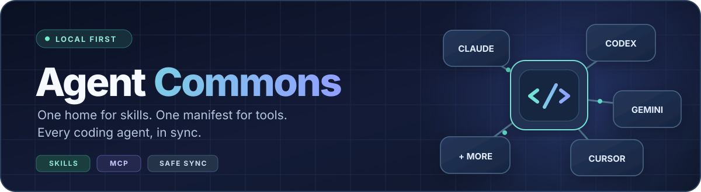

<div align="center">



<br />

[](https://github.com/neosoda/agent-commons/actions/workflows/ci.yml)
[](https://github.com/neosoda/agent-commons/releases)
[](https://nodejs.org)
[](LICENSE)
[](#compatibility)

**The local-first home for your AI coding agents.**  
Share skills, keep MCP configurations in sync, and protect existing setups.

[**Get started**](#quick-start) · [How it works](#how-it-works) · [Compatibility](#compatibility) · [Safety](#designed-to-be-safe) · [Contribute](CONTRIBUTING.md)

</div>

---

## Stop configuring the same thing seventeen times.

Claude Code, Codex, Cursor, Gemini, OpenCode and other coding agents all want their own skills and tools. Agent Commons gives them **a shared source of truth**—without forcing you to abandon their native configurations.

| 🧩 **One skills library** | 🔌 **One MCP manifest** | 🛟 **A way back** |
|:--|:--|:--|
| Reuse the same `SKILL.md` folders through filesystem links—no needless copies. | Add shared servers to each supported agent's native JSON, JSONC or TOML configuration. | Preview changes, keep conflicts intact, capture snapshots and restore previous state. |

**At a glance:** 17 registered agent environments · 9 with Skills + MCP adapters · 8 with Skills synchronization · Windows, macOS and Linux CI.

> [!NOTE]
> **Distribution:** See [GitHub Releases](https://github.com/neosoda/agent-commons/releases) for the latest published version and Windows portable assets. The optional npm package is available only after [its first verified registry publication](https://www.npmjs.com/package/@neosoda/agent-commons); if npm has not published it yet, use the source instructions below. Never assume `npx @neosoda/agent-commons` works until the registry confirms the version.

## Quick start

**Requirements:** Node.js **22+**, npm, and Git.

~~~bash
git clone https://github.com/neosoda/agent-commons.git
cd agent-commons
npm ci
npm run build

# Inspect your environment — no agent configuration changes
node dist/cli/index.js doctor
node dist/cli/index.js list

# Preview every planned synchronization
node dist/cli/index.js sync --dry-run
~~~

When the preview looks right, take a baseline backup and apply:

~~~bash
node dist/cli/index.js backup
node dist/cli/index.js sync
~~~

**New to Agent Commons?** Start with only one agent, using `sync --dry-run --agent codex` (replace `codex` with your agent's ID). The `--home <path>` flag lets you test against a separate home directory first.

## Local Skill Hub — browser dashboard

**New:** a responsive, dependency-free local interface to manage Agent Commons without memorizing commands.

After cloning and building the project, run:

```bash
node dist/cli/index.js web
# or npm run web (builds first)
```

Your browser opens at **http://127.0.0.1:4173**. Override the port with `web --port 5050`, use `--no-open` on headless machines, or `--home /temporary/test-home` to test safely against a separate environment. Stop with **Ctrl+C**.

The dashboard provides:

- **Overview:** local skills, installed agent environments, MCP server names, backups and quick integrity status.
- **Skill catalog:** searchable, category-filtered references; inspect pinned upstream source/license; preview and explicitly approve install/update/uninstall where supported.
- **Agents & profiles:** view installed agents, assign shared skills and catalog categories per agent, save selections privately, preview synchronized changes and apply deliberately (skills only; unrelated settings untouched).
- **MCP server editor:** add an explicitly configured stdio or HTTP(S)/SSE entry, change existing per-agent inclusion/exclusion/enablement, or remove a named server. Every write is previewed, revision-checked and snapshotted; existing credentials and command options are never returned to the browser.
- **MCP synchronization:** preview the separate full skills + MCP synchronization, and apply it only after explicit confirmation. Changing the central manifest does not automatically synchronize agents.
- **Integrity & diagnostics:** strictly offline Git-hash audit, plus on-demand agent diagnostics for broken links and MCP configuration health.
- **Backups:** create snapshots and restore a known snapshot after typing its exact ID to confirm.


**MCP editor safety:** The browser does not expose raw MCP commands, arguments, URLs, environment values, or agent overrides for existing servers. Editing an existing server is intentionally limited to its agent routing and enabled state; sensitive/advanced fields must be maintained in the original local manifest. New entries support stdio or HTTP(S)/SSE without embedded credentials. Only `\${ENV_VAR}`-style environment references are accepted by the backend, and editing the central manifest never executes a server. All writes create a snapshot and reject stale previews.

**Safety defaults:** the server listens only on `127.0.0.1`; it refuses cross-origin and foreign-Host requests, requires a random per-process CSRF token for changes, and never loads code, fonts or assets from third-party CDNs. There is **no login and no public network access**. Do not expose this local administrative UI with a proxy, port-forward or tunnel; it is intentionally **not hardened for remote multiuser access**. The dashboard does not start a daemon, install skills automatically, upload private reports or synchronize agents in the background. Skill source/license metadata does not certify script safety.

### Windows portable package (no Node installation)

The **Windows portable ZIP** is built and verified by the [Windows portable CI workflow](https://github.com/neosoda/agent-commons/actions/workflows/windows-portable.yml). Prefer the ZIP and SHA-256 checksum from the [latest published GitHub Release](https://github.com/neosoda/agent-commons/releases/latest). If there is not yet an official release with both files, use the artifact from a **successful** CI run for testing only.

1. Download `AgentCommons-win-x64-portable.zip` and its `.sha256` checksum from GitHub Releases (or the verified workflow artifact for testing).
2. Extract the complete archive into a folder you control.
3. Double-click `AgentCommonsPortable\Start-AgentCommons.cmd`.
4. The Skill Hub opens locally in your browser. Close the console with Ctrl+C to stop it.

The ZIP contains the compiled npm distribution, its production dependencies, and a pinned official **Node.js 24.22.2 LTS executable**. The build checks the Node executable against the SHA-256 manifest published by nodejs.org, launches the package's CLI and verifies a real HTTP 200 response from its local dashboard before uploading it. The ZIP also includes a SHA-256 checksum; it is **not code-signed**. No administrator privileges, Docker, Node installation, Windows service or public network binding are required.

For operators who already have Node.js 22+, `npm run web` remains available from the checked-out source.

### Browser-tested quality gates

The [Chromium browser QA workflow](https://github.com/neosoda/agent-commons/actions/workflows/web-qa.yml) opens five dashboard views across five viewport sizes (1920×1080, 1440×900, 1280×720, 768×1024 and 390×844), checks navigation, filtering, dialogs, JavaScript errors, CSP rejections, and horizontal overflow, and uploads screenshots from a synthetic empty user environment. Screenshots never contain personal agent configuration data.

## How it works

~~~mermaid
flowchart TB
    A["~/.agents/skills/<br/>Shared SKILL.md folders"] --> C["Agent Commons"]
    B["~/.agents/mcp.json<br/>Shared MCP definitions"] --> C
    C --> D["Claude Code"]
    C --> E["Codex"]
    C --> F["Cursor"]
    C --> G["Gemini / Antigravity"]
    C --> H["OpenCode + others"]
    C -. "Backups before changes" .-> I["~/.agents/backups/"]
~~~

**Skills** use NTFS directory junctions on Windows and directory symlinks on macOS/Linux. Agent Commons compares physical copies before replacing them with links. If a local copy differs, it is left untouched unless you explicitly use `--force`.

**MCP** is different: Agent Commons **merges individual servers** into native config files rather than linking whole files together. It preserves unrelated settings and existing server definitions; conflicts require an explicit `--force`.

### 1. Create your shared library

Each skill is a physical directory containing a `SKILL.md` file.

~~~text
~/.agents/
├── skills/
│   ├── code-review/
│   │   └── SKILL.md
│   └── security-check/
│       └── SKILL.md
├── mcp.json
└── backups/
~~~

Already have unique local skills scattered between agents? `sync --adopt` can copy them into the common library and replace those original folders with links. **Preview it first** with `sync --adopt --dry-run`.

### 2. Declare MCP servers once

Create `~/.agents/mcp.json`:

~~~json
{
  "mcpServers": {
    "my-local-tools": {
      "type": "stdio",
      "command": "node",
      "args": ["/absolute/path/to/my-mcp-server.js"],
      "agents": ["claude-code", "codex", "cursor"]
    }
  }
}
~~~

This is an **example**, not a bundled server. Replace the path with an MCP server you already have installed.

Agent Commons handles the destination dialect:

| Agent format | Example destination | Behavior |
|---|---|---|
| **JSON** | `~/.claude.json`, `~/.gemini/settings.json` | Merge into `mcpServers` |
| **JSONC** | `~/.config/opencode/opencode.jsonc` | Merge into `mcp`, preserving comments and formatting |
| **TOML** | `~/.codex/config.toml` | Merge `[mcp_servers.<name>]` sections |

You can also use `excludeAgents`, `agentOverrides` and environment placeholders such as `${MY_API_TOKEN}`. **Placeholders are preserved, not a secret vault**—configure credentials securely in the target environment and never commit real credentials to your shared manifest.

### 3. Preview, sync, recover

~~~bash
# Inspect
node dist/cli/index.js doctor
node dist/cli/index.js sync --dry-run

# Make a baseline snapshot, then synchronize
node dist/cli/index.js backup
node dist/cli/index.js sync

# Inspect or restore snapshots
node dist/cli/index.js restore --list
node dist/cli/index.js restore snapshot-<id>
~~~

`restore` replaces the currently managed paths with their saved state. Review the target snapshot before running it: **restoration is a mutating operation**.

**If restore reports an incomplete rollback:** stop and do not retry automatically. Original data may be recoverable in a hidden `.agent-commons-restore-*` staging directory **next to the affected destination**. Within that directory, `original` is the displaced pre-restore file/directory, `replacement` is a prepared snapshot copy (when not installed), and `discarded` may hold a rolled-back replacement. Preserve the entire staging directory before manual recovery. These folders may contain credentials or private agent configuration; do not upload or share them. No process automatically repairs a failed rollback or guarantees recovery after a power/storage failure.

## Explore Skills — public Skill Hub

**103 upstream skills** currently have verified source and license references. Browse them directly on GitHub in the [public Skills index](docs/skills/README.md).

```bash
node dist/cli/index.js catalog list
node dist/cli/index.js catalog search playwright
node dist/cli/index.js catalog info skill-creator
node dist/cli/index.js catalog list --category ai-automation
node dist/cli/index.js catalog list --source github --license Apache-2.0
```

All browsing is **offline** using [catalog/skills.json](catalog/skills.json); `--json` also works. An `INSTALLED` marker indicates a matching local skill in your shared library.

**Safety boundary:** The public catalog still contains only metadata and pinned references. `catalog install` supports a **limited, explicit opt-in GitHub installer** for non-archived skills: the default is a file-list preview, and `--yes` is required before any changes. It verifies Git blob hashes, stages the new skill and refuses to overwrite an existing one. **No third-party scripts are executed.** GitLab/Codeberg installation and updates remain disabled; removal is limited to intact managed skills; source/license checks are not security audits.

The separate `catalog` / `catalog --json` commands still inventory your **local private library**, using lockfile provenance if available. Do **not** commit those local reports without review. Private/local skill reports are never bundled or published; public upstream references are verified individually. **14 historical HyperFrames skills are marked archived** and link to the last verified pre-retirement commit. Not every installed local skill is available in this public catalog.

See [catalog policy](docs/SKILL_CATALOG.md) and [categories](catalog/categories.json).

---

### Preview a pinned skill installation

```bash
# Fetch only Git tree metadata to see the exact files (no writes)
node dist/cli/index.js catalog install skill-creator

# Explicitly accept installation into ~/.agents/skills/
node dist/cli/index.js catalog install skill-creator --yes
```

This experimental path supports **public GitHub repositories only**, is limited to **150 files / 8 MiB** per skill and refuses links, unsafe names, existing targets and archived sources. It creates a snapshot before installing, verifies each Git blob hash, then atomically moves the staged files into the shared library. It does **not** run scripts, overwrite custom skills or synchronize agents automatically. Review the upstream scripts and provenance yourself before installing.

`catalog uninstall <id>` now provides a **fully offline verification and removal preview**. It refuses any untracked/changed files or folders, links inside the skill, and any skill linked to an installed agent. Only a directory with an intact Agent Commons management receipt can be removed with `--yes`. A focused snapshot of the skill is created before removal; run `agent-commons restore <snapshot-id>` to put it back.

```bash
node dist/cli/index.js catalog uninstall skill-creator
node dist/cli/index.js catalog uninstall skill-creator --yes
```

**Offline integrity audit:** `catalog verify [id]` checks management receipts, tracked Git blob hashes, unexpected files and nested symlinks/junctions without downloads or filesystem changes. Without an ID, only locally present skills from the reviewed public catalog are audited; unrelated private skills are not scanned or disclosed. Results distinguish `intact`, `modified`, `untracked`, `missing`, `unmanaged` and `unsafe`. Any non-intact result produces a nonzero exit status; `--json` provides a machine-readable report. Matching hashes **do not** imply that upstream code has been security-audited.

```bash
node dist/cli/index.js catalog verify
node dist/cli/index.js catalog verify skill-creator --json
```

`catalog outdated` now compares the installed Agent Commons management receipts to **the immutable commits pinned in the bundled public catalog**, entirely offline. This is not a check for the latest upstream changes.

```bash
# Offline: compare installed managed skills against catalog revisions
node dist/cli/index.js catalog outdated

# Online: preview exact changes from old pinned commit to the catalog's pinned commit
node dist/cli/index.js catalog update skill-creator

# Explicitly approve after inspecting the upstream changes
node dist/cli/index.js catalog update skill-creator --yes
```

Updates only work when a skill was **previously installed by Agent Commons**, is **unmodified**, has **no unknown files or directories**, has a **different pinned commit** in the curated catalog, and is **not linked to an agent**. The updater checks every downloaded Git blob, creates a focused restore snapshot, and uses a staged directory replacement. If the swap fails it attempts to put the previous directory back. No code is executed and there are no silent or automatic updates.

The project never decides that a mutable GitHub branch is a safe update. No release is published automatically. The package has not been published on npm.

### Sync only the skills your agent needs

You **do not** have to load your entire shared library into every agent. Select individual central skills or one or more categories:

```bash
# Preview a single skill for Codex, without touching MCP settings
node dist/cli/index.js sync --skill skill-creator --agent codex --dry-run

# Sync a selected skill to Codex
node dist/cli/index.js sync --skill skill-creator --agent codex

# Sync all locally installed skills tagged "design" in the public catalog
node dist/cli/index.js sync --profile design --agent claude-code --dry-run
```

The category IDs are `development`, `devops`, `security`, `design`, `ai-automation`, `documentation` and `productivity`. Repeating `--skill` or `--profile` selects multiple entries.

Filters affect **only skills**, never MCP configurations. Unknown skill IDs and categories fail before any writes; an empty matched profile refuses to run. Skills not present in the public catalog are **not automatically included in category profiles**, but remain selectable by explicit `--skill`. Mixing `--skill` with `--profile` is not supported, and `--adopt` cannot be used with a filtered sync.

Without a filter, `sync` behaves exactly as before. No agent configuration is permanently changed by browsing the catalog.

### Save a different skills profile for each agent

Profiles are **private, local preferences** kept in `~/.agents/agent-profiles.json`. Save a set of skills and categories once, then apply all configured agents together. **Saving never modifies your installed agents**.

```bash
# Codex receives the coding-agent skill plus all locally installed design skills
node dist/cli/index.js profiles set codex --skill skill-creator --profile design

# Claude Code receives only locally installed AI/automation skills
node dist/cli/index.js profiles set claude-code --profile ai-automation

# Inspect local preferences without touching skills or MCP configurations
node dist/cli/index.js profiles list
node dist/cli/index.js profiles show codex

# Simulate agent-specific changes, then apply only after reviewing
node dist/cli/index.js sync --saved-profiles --dry-run
node dist/cli/index.js sync --saved-profiles

# Remove a saved preference without unlinking or deleting existing skills
node dist/cli/index.js profiles clear codex
```

The profile file is never uploaded to GitHub or bundled into the public catalog. Each agent gets only the specified local skills and categories, and the entire selection is validated **before any synchronization changes**. Multiple agents are handled by a single normal sync snapshot/rollback. Missing skills or empty profile matches stop the operation; unavailable agents are skipped. An optional `--agent codex` limits the operation to one configured agent. No MCP modifications, forced replacements, downloads, automatic link removals or background synchronization occur. Ordinary `sync` without `--saved-profiles` retains its previous behavior.

## Local skill provenance inventory

Agent Commons can now **inventory the actual skills installed in your shared library** and look up their origins in the existing Vercel Skills lockfile (`~/.agents/.skill-lock.json`; legacy `skills-lock.json` is also inspected).

```bash
node dist/cli/index.js catalog
node dist/cli/index.js catalog --json
node dist/cli/index.js catalog review
node dist/cli/index.js catalog review --json
```

**Private review mode** groups every local skill by what needs attention: missing source, absent license claim, mutable/unpinned version, shared upstream path (potential duplicate), or pending human review. Categories are suggested from names but never treated as verified. Nothing is sent to GitHub or executed.

On Windows, store the review **outside the repository**:

```powershell
cd A:\PROJETS\agent-commons
git pull --ff-only
npm ci
npm run build
node dist/cli/index.js catalog review --json > "$env:USERPROFILE\skill-catalog-review.private.json"
```

Review that file locally before deciding which entries can be proposed for the community catalog. It may disclose private project names or repository URLs.

The public catalog accepts reviewed skills with repository-specific paths and pinned license files from GitHub, GitLab and Codeberg. **Local reports are never promoted automatically.**


The report lists skill names, source URLs (where recorded), repository subpaths, pinned refs and **author-declared** license strings. Unknown sources and licenses are explicitly marked **unknown**. Every entry remains **unverified** until a person reviews the original repository and its license.

> [!WARNING]
> **Catalog output is local inventory, not an approved public skill pack.** Lockfile source URLs may reference private repositories. Do not commit the output to GitHub without reviewing every entry. Cataloging a third-party skill does **not** grant permission to redistribute its files or prove that it is safe to execute.

Nothing is downloaded, installed, synchronized or published by `catalog`. See [the catalog policy](docs/SKILL_CATALOG.md) for the intended workflow for a future opt-in public collection.

---

## CLI reference

| Command | Purpose |
|---|---|
| `doctor` | Diagnose detected agents, links and MCP configurations |
| `web [--port 4173] [--no-open]` | Open the local Skill Hub dashboard and manage skills, profiles and snapshots |
| `catalog list` / `catalog search <term>` | Browse the offline public Skill Hub |
| `catalog info <id>` | View upstream source, license and installed status |
| `catalog install <id>` | Preview GitHub pinned skill files without changes |
| `catalog install <id> --yes` | Explicitly approve installation of a new, non-archived GitHub skill |
| `catalog uninstall <id>` | Preview removal of an intact, managed and unlinked skill (offline) |
| `catalog uninstall <id> --yes` | Back up and safely remove that managed skill; restore by snapshot |
| `catalog` / `catalog --json` | Inspect the local private skill inventory (read-only) |
| `catalog review [--json]` | Find missing provenance, license claims, unpinned versions and possible duplicates locally |
| `catalog verify [id] [--json]` | Audit reviewed-catalog skills offline, without changes; nonzero exit on integrity failures |
| `list` | Inventory skills, MCP servers, agents and snapshots |
| `sync --dry-run` | Show planned changes without modifying agent configurations |
| `sync` | Synchronize compatible installed agents |
| `sync --skill <id> --agent <id>` | Link selected central skill(s) to selected agent(s) |
| `sync --profile design --agent <id>` | Link locally installed, catalog-classified design skills |
| `profiles set <agent-id> --skill <id>` | Store each agent's private skill choices without syncing |
| `sync --saved-profiles --dry-run` | Preview all saved per-agent selections; apply without dry-run |
| `sync --adopt` | Import unique local skills into the shared library |
| `sync --force` | Resolve differing copies/conflicting servers by replacing them **with backups** |
| `sync --agent codex` | Synchronize only the named agent (repeat `--agent` for more) |
| `sync --skills-only` / `sync --mcp-only` | Restrict the operation to one feature |
| `backup` | Make a manual snapshot |
| `restore --list` | List available snapshots |
| `restore <snapshot-id>` | Restore a selected snapshot |
| `list --json` / `doctor --json` | Machine-readable reports |
| `--home <path>` | Operate against an alternative user home |

Use `node dist/cli/index.js --help` for the full help, or `node dist/cli/index.js sync --help` for command-specific options. Once npm publishing is enabled, these commands will also be available through the `agent-commons` executable.

## Compatibility

**17 registered environments** in the source registry. This means their paths and file formats have automated coverage—not that their proprietary applications are launched and end-to-end verified in CI.

### Skills + MCP (9)

| Environment | Skills | MCP |
|---|:---:|---|
| Claude Code | ✓ | JSON |
| OpenAI Codex | ✓ | TOML |
| Cursor | ✓ | JSON |
| Gemini CLI | ✓ | JSON |
| Gemini Config | ✓ | JSON |
| Gemini Antigravity | ✓ | JSON |
| OpenCode | ✓ | JSON/JSONC |
| MiniMax | ✓ | JSON |
| Kiro | ✓ | JSON |

### Skills only (8)

| Environment | Support |
|---|---|
| Cline · Roo Code · Continue · Kimi | Skills |
| Hermes (home and AppData installations) | Skills |
| Aider Desk · Grok | Skills |

MCP for skills-only environments is **not yet implemented**. Actual agent directory layouts can change between vendor versions; please [open an issue](https://github.com/neosoda/agent-commons/issues) if detection or integration needs updating.

## Designed to be safe

- **Local-first.** No account, background daemon, telemetry or network routing is required for synchronization. Building from source and installing npm packages still use their usual package registries.
- **Non-destructive defaults.** Existing divergent skill folders and conflicting MCP definitions are preserved until you opt into `--force`.
- **Careful config editing.** JSONC comments, indentation and line endings are preserved during supported edits. Corrupted configurations are reported instead of overwritten.
- **Recoverable changes.** Mutating sync operations record per-path snapshots and attempt rollback after errors. Restore now preflights entries and expected backup payloads before destructive changes in the current source.
- **Windows-friendly.** Junctions avoid requiring Developer Mode or Administrator rights on compatible local filesystems. Some network filesystems cannot create them.
- **No bundled third-party skills.** Agent Commons distributes the sync engine, **not** someone else's skill library.

> [!CAUTION]
> A filesystem synchronizer can replace files. Always inspect `sync --dry-run`, keep an independent backup of important agent configurations, and treat `--force` and `restore` as deliberate changes. This project is pre-1.0 software.

## Development

~~~bash
npm ci
npm run typecheck
npm test
npm pack --dry-run
~~~

CI runs on **Windows, macOS and Ubuntu** with **Node.js 22 and 24**. Tests use isolated temporary homes; the registered agent adapters are tested without starting proprietary agents.

Want to help? See [CONTRIBUTING.md](CONTRIBUTING.md), [SECURITY.md](SECURITY.md), the [changelog](CHANGELOG.md), or [open an issue](https://github.com/neosoda/agent-commons/issues). We welcome reproducible bug reports, additional adapter tests and documentation fixes.

---

<div align="center">

**One source of truth. Less configuration drift. More time building.**

Made by [@neosoda](https://github.com/neosoda) · [MIT licensed](LICENSE) · [Releases](https://github.com/neosoda/agent-commons/releases)

</div>
