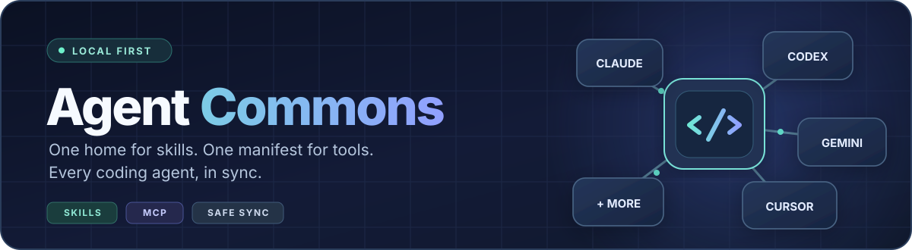

<div align="center">

**🇫🇷 Français** · [🇬🇧 English](README.en.md)



[](https://github.com/neosoda/agent-commons/actions/workflows/ci.yml)
[](https://github.com/neosoda/agent-commons/releases)
[](https://nodejs.org)
[](LICENSE)

**Une configuration commune pour les agents IA, sans sacrifier le contrôle.**

</div>

Agent Commons centralise vos **skills**, vos serveurs **MCP** et leur synchronisation pour Codex, Claude Code, Gemini CLI, Antigravity, OpenCode et d'autres outils. Une interface locale, un catalogue consultable, des opérations prévisualisées et des sauvegardes : plus besoin de tout reconfigurer à la main.

**État vérifié le 28 novembre 2026 :** 21 environnements IA reconnus, 225 **références** de skills (34 dépôts, dont 13 compétences [100x Engineer](docs/100X_ENGINEER.md) v0.1.1 épinglées), 11 **rérences** MCP (dont XERJ et Sellbird). Les références ne sont pas des packages installés. Référence baseline : les 11 contrôles GitHub (6 OS/Node, 3 XERJ réels, Chromium et Windows portable) sont passés sur `main` `2570fabf`, publié en [v0.6.1](https://github.com/neosoda/agent-commons/releases/tag/v0.6.1) (recontrôler les PR en cours sur GitHub pour tout commit ultérieur).

> **État de la release :** [v0.6.1](https://github.com/neosoda/agent-commons/releases/tag/v0.6.1) livre le correctif de sécurité Windows 8.3 et le **moteur de missions expérimental** depuis `main` (`2570fabf`). Ce moteur reste **expérimental** (sans sandbox OS ni recette matérielle LM Studio/RTX complète) ; l'archive Windows portable est **non signée** et aucune publication npm n'est effectuée. Voir [capacités et preuves](docs/CAPABILITIES.md).

## Installation

**Windows portable :** télécharger la [dernière release GitHub](https://github.com/neosoda/agent-commons/releases/latest), vérifier le fichier `.sha256`, décompresser l'archive complète, lancer `AgentCommonsPortable/Start-AgentCommons.cmd`. Pas de Node.js à installer pour cette archive.

**Depuis les sources :** Node.js >=22, npm et Git.

```bash
git clone https://github.com/neosoda/agent-commons.git
cd agent-commons
npm ci
npm run build
node dist/cli/index.js doctor
node dist/cli/index.js sync --dry-run
# Après inspection du plan uniquement :
node dist/cli/index.js backup
node dist/cli/index.js sync
# Interface locale (127.0.0.1 seulement)
node dist/cli/index.js web
```

Un premier essai sans modifier votre compte est possible avec `--home <dossier-de-test>`. `doctor` ne lance pas les serveurs MCP ; `mcp probe` les teste **activement** sur demande. L'installation npm du paquet `@neosoda/agent-commons` **n'est pas attestée publiée** : préférer GitHub et les sources tant que la fiche npm n'est pas vérifiée.

## Sellbird (optionnel)

[Sellbird](https://github.com/ethanplusai/sellbird) v0.5.0 est référencé comme MCP externe manuel (AGPL-3.0), avec profil `outreach` dédié. Installation indépendante, synchronisation explicite, consultation et préparation de brouillons ; aucun envoi ni autopilot activé par Agent Commons. [Configuration et sécurité](docs/SELLBIRD.md).

## Recherche locale XERJ (optionnelle)

**XERJ v1.0.0-rc.104** est intégré à l’Extension Manager et au MCP Control Center : installation officielle SHA-256, détection d’exécutable existant, nœud local, autorisation de dossiers, indexation/recherche, synchronisation MCP ciblée. Pas de téléchargement depuis le catalogue ni d’activation automatique. La mémoire SQLite reste inchangée ; Query-1 et Reader-1 ne sont pas déployés. **[Guide XERJ et exemple Codex/Claude](docs/XERJ.md).**

## Ce que vous pouvez faire

- **Configurer plusieurs clients :** détecter leurs formats natifs, synchroniser les skills et MCP sélectionnés, gérer les profils, restaurer les snapshots.
- **Découvrir sans tout charger :** chercher dans le catalogue, router par métadonnées, ne charger que le `SKILL.md` pertinent. Aucun catalogue de skills injecté dans le prompt.
- **Gérer les extensions :** installer/mettre à jour les skills approuvés et certains packages MCP épinglés via l'Extension Manager, puis les **configurer et synchroniser séparément**. Les MCP installés ne sont pas automatiquement utilisables.
- **Piloter des missions locales (expérimental sur `main`) :** modèle LM Studio compatible OpenAI, outils autorisés, plan, mémoire SQLite FTS5 par dépôt, file persistante, worker et Mission Control. Les autres CLI IA n'émettent que des **avis facultatifs**, pas des tâches déléguées en parallèle.

```bash
# Découverte de skills sans injection massive
node dist/cli/index.js skills route "audit UX d'une application" --json
node dist/cli/index.js skills load ux-psychology

# Mission en lecture seule sur une branche de test, après démarrage de LM Studio
node dist/runtime/cli.js --workspace "/chemin/vers/un-depot" --task "Analyse ce dépôt sans rien modifier" --model "ID_EXACT_LM_STUDIO"
```

**Sécurité :** Skill Hub non authentifié, lié strictement à `127.0.0.1` ; **aucune exposition directe au LAN ou à Internet**. L'écriture du runtime, les tests du dépôt, les appels MCP et les extensions tierces exigent des autorisations adaptées. Pas encore de sandbox OS robuste ni de validation complète du nouveau moteur sur une machine LM Studio/RTX réelle.


### Loop Engineering universel

Le skill original [Universal Product Engineering](skills/universal-product-engineering/SKILL.md) (V2) orchestre des cycles bornés de développement, tests, enrichissement et critique UX/UI anti-slop avec baseline, scorecard, hiérarchie de preuves et checkpoints. Après installation explicite et synchronisation vers le client choisi, demander : « Exécute le skill universal-product-engineering sur le projet courant. » Voir le [guide d'exploitation](docs/SKILLS_AND_MCP.md#loop-engineering-universel).

## 100x Engineer (optionnel)

[100x Engineer](https://github.com/DeadInternetStudios/100x-engineer-skill) **v0.1.1** (MIT) est intégré de façon optionnelle dans l'Extension Manager (`agent-commons 100x ...` et Skill Hub), avec vérification SHA-256 du `.tgz`, 13 skills épinglés, trois profils d'exécution (`lite` par défaut, `standard`, `deep`), plafonds stricts (0 appel cloud/payant implicite), synergie optionnelle avec `universal-product-engineering` et affichage des invariants/captures dans Mission Control. Une vérification bornée ou échantillonnée ne vaut pas preuve exhaustive. **[Guide 100x Engineer](docs/100X_ENGINEER.md).**

## Documentation : un chemin court vers la bonne source

| Besoin | Document |
|---|---|
| Nouvel agent ou contributeur | [AGENTS.md](AGENTS.md) → [handoff opérationnel](PROJECT_HANDOFF.md) |
| Architecture et choix validés | [Architecture](docs/ARCHITECTURE.md) · [Décisions](docs/DECISIONS.md) |
| Fonctions disponibles, preuves, limites | [Capacités](docs/CAPABILITIES.md) |
| Skills, MCP, routage et permissions | [Skills & MCP](docs/SKILLS_AND_MCP.md) · [Extension Manager](docs/EXTENSION_MANAGER.md) |
| Exécuter une mission autonome | [Runtime](docs/AGENT_RUNTIME.md) |
| Sécurité et suites techniques | [SECURITY.md](SECURITY.md) · [Roadmap](docs/ROADMAP.md) |
| Diagnostiquer et tester | [Diagnostics](docs/DIAGNOSTICS.md) · [Recette Windows](docs/qa/RELEASE_ACCEPTANCE.md) |
| Historique de versions et sources anciennes | [Changelog](CHANGELOG.md) · [Archives](docs/archive/INDEX.md) |

Agent Commons est **indépendant de SentinelBrain** : modèle sur un autre PC, distribution de skills/MCP sur le LAN et services mutualisés sont des **pistes futures**, pas un déploiement annoncé.

## Crédits et licences des projets sources

Le code Agent Commons est sous [licence MIT](LICENSE). Le catalogue référence des projets tiers **sans en absorber la licence ni présumer leur innocuité**. Tous les auteurs, sources et licences déclarées restent crédités dans l'[index détaillé](docs/skills/README.md). Les intégrations propres à un projet ont aussi leurs guides sous `docs/`.

<!-- BEGIN GENERATED SKILL REPOSITORY CREDITS -->
Le catalogue public référence **225 skills provenant de 34 dépôts sources**. Il s'agit **uniquement de métadonnées** : Agent Commons ne regroupe pas et n'installe pas automatiquement ces skills. Les licences sont indiquées pour chaque skill épinglé dans [l'index complet](docs/skills/README.md) ; si plusieurs licences figurent pour un dépôt, vérifiez celle applicable à chaque skill.

| Dépôt source | Auteur / responsable | Skills référencés | Licence(s) déclarée(s) |
|:--|:--|--:|:--|
| [affaan-m/ECC](https://github.com/affaan-m/ECC) | Affaan Mustafa / ECC contributors | 71 | MIT |
| [AgricIDaniel/claude-seo](https://github.com/AgricIDaniel/claude-seo) | AgriciDaniel | 1 | MIT |
| [anthropics/skills](https://github.com/anthropics/skills) | Anthropic | 4 | Apache-2.0 |
| [cathrynlavery/diagram-design](https://github.com/cathrynlavery/diagram-design) | Cathryn Lavery | 1 | MIT |
| [cloudflare/security-audit-skill](https://github.com/cloudflare/security-audit-skill) | Cloudflare | 1 | MIT |
| [coreyhaines31/marketingskills](https://github.com/coreyhaines31/marketingskills) | Corey Haines | 1 | MIT |
| [DeadInternetStudios/100x-engineer-skill](https://github.com/DeadInternetStudios/100x-engineer-skill) | DeadInternetStudios | 13 | MIT |
| [DojoCodingLabs/remotion-superpowers](https://github.com/DojoCodingLabs/remotion-superpowers) | Dojo Coding Labs | 15 | MIT |
| [ecapri-dev/simulab-skill](https://github.com/ecapri-dev/simulab-skill) | ecapri-dev (@0xKapri) | 1 | MIT (bundled fonts: OFL-1.1) |
| [frankxai/awesome-hermes-agent-skills](https://github.com/frankxai/awesome-hermes-agent-skills) | Frank Riemer / GenCreator | 1 | MIT |
| [heygen-com/hyperframes](https://github.com/heygen-com/hyperframes) | HeyGen | 21 | Apache-2.0 |
| [Jakeschincariol/founder-skill](https://github.com/Jakeschincariol/founder-skill) | Jake Schincariol | 11 | MIT |
| [jmanico/grim-prompter](https://github.com/jmanico/grim-prompter) | Jim Manico / Manicode Security | 1 | MIT |
| [JuliusBrussee/caveman](https://github.com/JuliusBrussee/caveman) | JuliusBrussee | 22 | Apache-2.0 |
| [latent-spaces/brag](https://github.com/latent-spaces/brag) | latent-spaces | 1 | MIT |
| [lemomo-ai/lemo-opuscar](https://github.com/lemomo-ai/lemo-opuscar) | Lemomo / LemoLab | 1 | CC-BY-NC-4.0 (skill/docs); MIT (script) |
| [markoblogo/abvx-agent-skills](https://github.com/markoblogo/abvx-agent-skills) | Anton Biletskiy-Volokh | 4 | MIT |
| [mattpocock/skills](https://github.com/mattpocock/skills) | Matt Pocock | 5 | MIT |
| [morellid/ai-act-skill](https://github.com/morellid/ai-act-skill) | Davide Morelli | 1 | MIT |
| [neosoda/agent-commons](https://github.com/neosoda/agent-commons) | Agent Commons contributors | 2 | MIT |
| [nextlevelbuilder/ui-ux-pro-max-skill](https://github.com/nextlevelbuilder/ui-ux-pro-max-skill) | Next Level Builder | 7 | Apache-2.0 / MIT |
| [ninjasweb/video-engine-skill](https://github.com/ninjasweb/video-engine-skill) | ninjasweb | 1 | MIT |
| [noamdorr/saas-product-demo-video](https://github.com/noamdorr/saas-product-demo-video) | Noam Dorr | 1 | MIT |
| [nutlope/hallmark](https://github.com/nutlope/hallmark) | nutlope | 1 | MIT |
| [NVIDIA/SkillSpector](https://github.com/NVIDIA/SkillSpector) | NVIDIA | 1 | Apache-2.0 |
| [pbakaus/impeccable](https://github.com/pbakaus/impeccable) | pbakaus | 1 | Apache-2.0 |
| [shadcn/improve](https://github.com/shadcn/improve) | shadcn | 1 | MIT |
| [thedotmack/claude-mem](https://github.com/thedotmack/claude-mem) | thedotmack | 28 | Apache-2.0 |
| [vercel-labs/agent-desktop](https://github.com/vercel-labs/agent-desktop) | Vercel Labs | 1 | Apache-2.0 |
| [vercel-labs/skills](https://github.com/vercel-labs/skills) | Vercel | 1 | MIT |
| [viettranx/3dviz-pro-max](https://github.com/viettranx/3dviz-pro-max) | viettranx | 1 | MIT |
| [Vincentwei1021/video-shotcraft](https://github.com/Vincentwei1021/video-shotcraft) | Vincentwei1021 | 1 | Apache-2.0 |
| [wheresryan22/anatomy](https://github.com/wheresryan22/anatomy) | Ryan (wheresryan22) | 1 | MIT |
| [zeative/motion-educator](https://github.com/zeative/motion-educator) | Zeative | 1 | MIT |
<!-- END GENERATED SKILL REPOSITORY CREDITS -->

Merci notamment à [Model Context Protocol](https://github.com/modelcontextprotocol/servers), [Microsoft Playwright](https://github.com/microsoft/playwright-mcp), [Docker MCP Gateway](https://github.com/docker/mcp-gateway), [GitHub MCP Server](https://github.com/github/github-mcp-server) et aux mainteneurs des skills répertoriés. Les sources et versions réellement intégrées doivent toujours être vérifiées avant exécution.

[Contribuer](CONTRIBUTING.md) · [Signaler une vulnérabilité](SECURITY.md) · [Releases](https://github.com/neosoda/agent-commons/releases)
