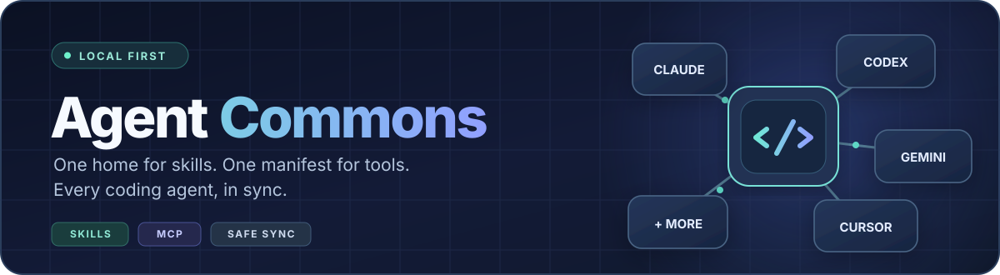
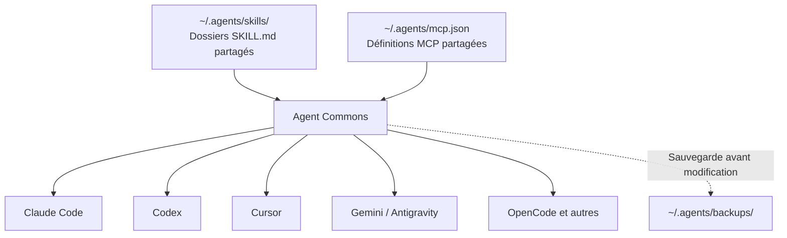

<div align="center">

**🇫🇷 Français** · [🇬🇧 English](README.en.md)



<br />

[](https://github.com/neosoda/agent-commons/actions/workflows/ci.yml)
[](https://github.com/neosoda/agent-commons/releases)
[](https://nodejs.org)
[](LICENSE)
[](#compatibilité)

**Le point central, local et sécurisé, pour vos agents IA de développement.**  
Partagez vos skills, synchronisez les configurations MCP et préservez vos installations existantes.

[**Démarrer**](#démarrage-rapide) · [Fonctionnement](#fonctionnement) · [Compatibilité](#compatibilité) · [Sécurité](#conçu-pour-rester-sûr) · [Crédits](#crédits-et-projets-sources) · [Contribuer](CONTRIBUTING.md)

</div>

---

## Fini de configurer chaque agent séparément

Claude Code, Codex, Cursor, Gemini, OpenCode et les autres agents de développement utilisent chacun leurs propres skills et outils. **Agent Commons réunit leurs configurations dans une source commune**, tout en conservant les formats natifs des logiciels.

| 🧩 **Une bibliothèque de skills** | 🔌 **Un manifeste MCP** | 🛟 **Une marche arrière** |
|:--|:--|:--|
| Réutilisez les dossiers `SKILL.md` grâce aux liens système, sans copies inutiles. | Déclarez les serveurs MCP partagés et synchronisez-les dans les fichiers JSON, JSONC ou TOML de chaque agent compatible. | Prévisualisez les changements, conservez les conflits, réalisez des sauvegardes et restaurez un état précédent. |

**En bref :** 18 environnements reconnus · 9 adaptateurs Skills + MCP · 8 adaptateurs Skills uniquement · 1 client MCP uniquement (LM Studio) · CI sous Windows, macOS et Linux.

> [!NOTE]
> **Distribution :** consultez les [releases GitHub](https://github.com/neosoda/agent-commons/releases) pour la dernière version effectivement publiée et les archives Windows portables. Le paquet npm facultatif ne doit être considéré comme disponible qu'après [vérification de sa publication sur npm](https://www.npmjs.com/package/@neosoda/agent-commons). Ne présumez pas que `npx @neosoda/agent-commons` fonctionne avant cette vérification.

## Installer Agent Commons

**Sous Windows :** la solution la plus simple est l'[archive ZIP portable](https://github.com/neosoda/agent-commons/releases/latest). Téléchargez également son fichier `.sha256`, vérifiez l'empreinte, extrayez l'archive complète, puis lancez `AgentCommonsPortable/Start-AgentCommons.cmd`. Aucun administrateur ni installation de Node.js n'est nécessaire.

**Depuis les sources :** utilisez les instructions multiplateformes ci-dessous avec Node.js 22 ou supérieur. L'installation depuis npm est facultative et ne doit pas être annoncée comme fonctionnelle avant la première publication effective.

**Téléchargements officiels :** privilégiez la [dernière release GitHub vérifiée](https://github.com/neosoda/agent-commons/releases/latest) et son empreinte SHA-256. Le [dossier de vérification v0.3.0](docs/releases/v0.3.0.md) reste disponible à titre historique. Une version publiée n'est jamais remplacée silencieusement sous le même tag.

## Démarrage rapide

**Prérequis :** Node.js **22+**, npm et Git.

```bash
git clone https://github.com/neosoda/agent-commons.git
cd agent-commons
npm ci
npm run build

# Inspecter l'environnement sans modifier les agents
node dist/cli/index.js doctor
node dist/cli/index.js list

# Prévisualiser toutes les synchronisations
node dist/cli/index.js sync --dry-run
```

Une fois la prévisualisation vérifiée, créez une sauvegarde de référence et appliquez la synchronisation :

```bash
node dist/cli/index.js backup
node dist/cli/index.js sync
```

**Vous découvrez Agent Commons ?** Commencez avec un seul agent : `sync --dry-run --agent codex` (remplacez `codex` par son identifiant). L'option `--home <chemin>` permet aussi de tester le logiciel dans un répertoire utilisateur distinct.

## Découverte de skills économe en tokens

Ne sélectionnez **que les skills utiles à la tâche**, sans ajouter d'agents, de hooks ou de contenu dans le contexte automatiquement :

```bash
node dist/cli/index.js context "review TypeScript security" --agent codex --budget 800
node dist/cli/index.js context "test the API" --expand --budget 4000 --json
```

Par défaut, seul un court classement de métadonnées est renvoyé. `--expand` inclut le contenu complet des `SKILL.md` sélectionnés, sous réserve du budget estimé. Cette recherche hors ligne, en lecture seule, s'inspire d'idées de routage léger issues d'ECC, **sans intégrer ECC**. Le nombre de tokens est approximé, et non mesuré chez les fournisseurs. Consultez le [routage des skills](docs/CONTEXT_ROUTING.md).


### Smart Skill Router — sélection autonome, chargement ciblé

Le routeur existant `context` reste disponible. Les commandes `skills` ajoutent
un classement automatique **des métadonnées uniquement**, un aperçu des skills
absents et un chargement **explicite** des instructions locales, avec budget
de tokens configurable.

```bash
agent-commons skills route "Corrige mon Docker Compose" --json
agent-commons skills route "Coordonne plusieurs agents" --explain
agent-commons skills deps chief-of-staff
agent-commons skills load chief-of-staff --json
```

`skills route` ne charge **aucun** `SKILL.md` et n'installe rien. Seul
`skills load` lit le fichier d'un skill déjà installé. Un orchestrateur peut
enchaîner ces appels via leur sortie JSON ou l'API TypeScript, sans service
supplémentaire. Les agents natifs ne reçoivent pas d'injection automatique de
contexte. Configuration facultative : `~/.agents/skill-router.json` ; 3 skills
maximum et environ 4 000 tokens de contexte par défaut. Dépendances, collisions
et chemins dangereux sont contrôlés ; les ressources restent chargées à la demande.
[Documentation détaillée](docs/CONTEXT_ROUTING.md).


## Skill Hub local — interface web

Une interface locale, responsive et sans framework frontend supplémentaire permet de gérer Agent Commons sans mémoriser toutes ses commandes.

Après récupération et compilation du dépôt :

```bash
node dist/cli/index.js web
# ou npm run web (compile d'abord le projet)
```

Le navigateur s'ouvre sur **http://127.0.0.1:4173**. Vous pouvez choisir un autre port avec `web --port 5050`, éviter l'ouverture automatique avec `--no-open` ou utiliser `--home /chemin/test` pour un environnement isolé. Arrêtez le serveur avec **Ctrl+C**.

**Langues :** l'interface propose le **français** et l'**anglais**. Le choix est enregistré uniquement dans le stockage local de votre navigateur (`fr` ou `en`). La traduction française couvre notamment la navigation, les dialogues, les compteurs, les confirmations et les actions MCP. Les identifiants, noms d'agents, métadonnées externes et certains rapports techniques restent volontairement inchangés. Les deux langues disposent des mêmes protections et commandes côté serveur.

L'interface comporte :

- **Vue générale :** skills locaux, agents détectés, noms des serveurs MCP, sauvegardes et indicateurs d'intégrité.
- **Catalogue de skills :** recherche et filtres, provenance et licences, prévisualisation puis approbation explicite des installations, mises à jour et désinstallations compatibles.
- **Agents et profils :** choix des skills et catégories par agent, enregistrement local, simulation et synchronisation sélective, sans modifier les paramètres sans rapport.
- **Éditeur MCP :** création de serveurs stdio, HTTP(S) ou SSE, activation ou inclusion/exclusion d'agents, suppression contrôlée. Chaque écriture est prévisualisée, liée à une révision et sauvegardée ; les secrets existants ne sont pas renvoyés au navigateur.
- **Synchronisation MCP :** simulation distincte d'une synchronisation complète Skills + MCP et application après confirmation explicite. Modifier le manifeste central ne synchronise rien tout seul.
- **Intégrité :** contrôles de hachage Git hors ligne et diagnostics des liens cassés et configurations MCP.
- **Sauvegardes :** création et restauration de snapshots, avec saisie exacte de leur identifiant.

**Sécurité de l'éditeur MCP :** les commandes, arguments, URL, variables d'environnement et adaptations propres aux agents déjà enregistrés ne sont pas exposés dans le navigateur. Pour un serveur existant, l'édition se limite à son ciblage d'agents et à son état activé/désactivé. Les autres champs sensibles restent modifiables dans le manifeste local d'origine. Pour une nouvelle entrée, seules des références de variables d'environnement au format `${ENV_VAR}` sont acceptées ; l'éditeur n'exécute aucun serveur. Les modifications créent un snapshot et refusent toute prévisualisation périmée.

**Pendant une prévisualisation MCP ou de synchronisation :** les champs saisis restent présents si la vérification échoue, une erreur compréhensible apparaît et une nouvelle tentative reste possible. Les boutons sont temporairement désactivés afin d'éviter les doubles requêtes ; les prévisualisations devenues obsolètes après un changement de page ne déclenchent pas de confirmation surprise.

**Pendant l'édition :** Actualiser et Vérifier préservent les choix de profils non enregistrés et restaurent le focus lorsque c'est possible. Une réponse réseau ancienne ne peut pas écraser une vue plus récente. Les fenêtres de confirmation restent ouvertes jusqu'à la fin de l'opération ; les erreurs permettent de réessayer ou d'annuler.

**Protection par défaut :** le serveur n'écoute que sur `127.0.0.1`, refuse les requêtes avec Host/Origin étrangers, impose un jeton CSRF aléatoire pour les modifications et ne charge pas de ressources depuis des CDN externes. **Il n'y a ni authentification ni accès réseau public.** N'exposez jamais cette interface d'administration par proxy, redirection de port ou tunnel : elle n'est pas conçue pour une utilisation distante ou multiutilisateur. Pas de démon, télémétrie, téléchargement de rapports privés ou synchronisation automatique en arrière-plan. Une source et une licence référencées ne prouvent pas qu'un skill est sûr à exécuter.

### Archive Windows portable (sans installation de Node.js)

Le [workflow Windows portable](https://github.com/neosoda/agent-commons/actions/workflows/windows-portable.yml) construit et vérifie l'archive ZIP. Utilisez de préférence le ZIP officiel et son empreinte SHA-256 issus de la [dernière release](https://github.com/neosoda/agent-commons/releases/latest). Sinon, les artefacts d'un workflow **réussi** conviennent uniquement aux essais.

1. Téléchargez `AgentCommons-win-x64-portable.zip` et son fichier `.sha256`.
2. Extrayez **toute** l'archive dans un dossier de votre choix.
3. Double-cliquez sur `AgentCommonsPortable\Start-AgentCommons.cmd`.
4. Le Skill Hub s'ouvre localement ; fermez la console avec **Ctrl+C** pour l'arrêter.

L'archive contient le paquet npm compilé, ses dépendances de production et un exécutable officiel **Node.js 24.22.2 LTS épinglé**. La chaîne de vérification extrait le ZIP dans un chemin neuf contenant des espaces, lance le runtime embarqué dans un `HOME` synthétique, contrôle la version et l'accès HTTP 200. Le fichier Node est comparé à la somme SHA-256 publiée par nodejs.org. Le ZIP produit possède également une empreinte SHA-256 mais **n'est pas signé numériquement**. Il ne requiert ni droits administrateur, ni Docker, ni service Windows, ni ouverture sur le réseau.

Si Node.js 22+ est déjà installé, `npm run web` fonctionne directement depuis le dépôt compilé.

### Tests avec un vrai navigateur

Le [workflow de tests Chromium](https://github.com/neosoda/agent-commons/actions/workflows/web-qa.yml) parcourt cinq vues du tableau de bord sur cinq formats (1920×1080, 1440×900, 1280×720, 768×1024 et 390×844). Il vérifie navigation, filtres, boîtes de dialogue, erreurs JavaScript, refus CSP et absence de débordement horizontal. Les captures sont réalisées avec un répertoire utilisateur synthétique vide : elles n'exposent aucune configuration privée.

## Fonctionnement



Pour les **skills**, Agent Commons utilise des *jonctions NTFS* sous Windows et des *liens symboliques* sous macOS/Linux. Avant de remplacer une copie locale par un lien, il compare les répertoires. Une copie différente est laissée intacte sauf demande explicite avec `--force`.

Pour les **serveurs MCP**, il fusionne individuellement les entrées dans les fichiers de configuration natifs, au lieu de remplacer tout le fichier par un lien. Les paramètres sans rapport restent intacts et les conflits nécessitent également `--force`.

### 1. Créer la bibliothèque commune

Chaque skill doit être un répertoire physique possédant un fichier `SKILL.md`.

```text
~/.agents/
├── skills/
│   ├── code-review/
│   │   └── SKILL.md
│   └── security-check/
│       └── SKILL.md
├── mcp.json
└── backups/
```

Des skills sont déjà éparpillés entre plusieurs agents ? `sync --adopt` peut copier ceux qui sont uniques vers la bibliothèque commune puis remplacer les dossiers d'origine par des liens. **Prévisualisez impérativement** avec `sync --adopt --dry-run`.

### 2. Déclarer une seule fois les serveurs MCP

Créez `~/.agents/mcp.json` :

```json
{
  "mcpServers": {
    "my-local-tools": {
      "type": "stdio",
      "command": "node",
      "args": ["/absolute/path/to/my-mcp-server.js"],
      "agents": ["claude-code", "codex", "cursor"]
    }
  }
}
```

C'est un **exemple**, pas un serveur livré avec Agent Commons. Remplacez le chemin par celui d'un serveur MCP que vous avez réellement installé.

| Format agent | Fichier de destination type | Fonctionnement |
|---|---|---|
| **JSON** | `~/.claude.json`, `~/.gemini/settings.json` | Fusion dans `mcpServers` |
| **JSONC** | `~/.config/opencode/opencode.jsonc` | Fusion dans `mcp`, commentaires et mise en forme préservés |
| **TOML** | `~/.codex/config.toml` | Fusion des sections `[mcp_servers.<name>]` |

Les options `excludeAgents`, `agentOverrides` et les références à des variables d'environnement sont également prises en charge. **Une référence de variable n'est pas un coffre-fort à secrets** : protégez vos identifiants dans l'environnement cible et ne les versionnez jamais dans Git.

### 3. Prévisualiser, synchroniser, restaurer

```bash
# Examiner
node dist/cli/index.js doctor
node dist/cli/index.js sync --dry-run

# Sauvegarder puis synchroniser
node dist/cli/index.js backup
node dist/cli/index.js sync

# Examiner ou restaurer les sauvegardes
node dist/cli/index.js restore --list
node dist/cli/index.js restore snapshot-<id>
```

La commande `restore` remplace les chemins gérés par les versions sauvegardées. Vérifiez toujours le snapshot cible : **c'est une opération qui modifie les fichiers**.

**Si une restauration échoue partiellement :** arrêtez-vous, ne réessayez pas automatiquement. Les originaux peuvent subsister dans un dossier temporaire `.agent-commons-restore-*` voisin de la destination. Le sous-dossier `original` contient l'élément déplacé avant restauration ; `replacement` une copie préparée du snapshot, et `discarded` éventuellement une version annulée. Conservez le dossier complet avant toute récupération manuelle. Il peut contenir des secrets et des configurations privées : ne le partagez pas. Aucun mécanisme ne garantit un rétablissement automatique après panne ou coupure de courant.

## Explorer les skills — catalogue public

**183 skills externes** disposent actuellement de références vérifiées pour leur source et leur licence. Retrouvez-les dans [l'index public](docs/skills/README.md).

```bash
node dist/cli/index.js catalog list
node dist/cli/index.js catalog search playwright
node dist/cli/index.js catalog info skill-creator
node dist/cli/index.js catalog list --category ai-automation
node dist/cli/index.js catalog list --source github --license Apache-2.0
```

La consultation utilise `catalog/skills.json` **hors ligne** ; l'option `--json` est aussi disponible. L'indication `INSTALLED` signifie qu'un skill correspondant existe déjà dans votre bibliothèque centrale.

**Limites de sécurité :** le catalogue public contient seulement des métadonnées et des sources épinglées. `catalog install` fournit une installation GitHub limitée et optionnelle : simple prévisualisation par défaut, approbation explicite via `--yes`. Les blobs Git sont vérifiés, les fichiers sont préparés dans un dossier temporaire et une cible existante n'est jamais écrasée. **Aucun script tiers n'est exécuté.** L'installation depuis GitLab/Codeberg reste désactivée ; les suppressions ne concernent que les skills intacts gérés par Agent Commons. Une licence contrôlée ne vaut pas audit de sécurité.

Les commandes `catalog` et `catalog --json` recensent séparément la **bibliothèque locale privée**, avec les informations des éventuels fichiers de verrouillage. Ne publiez pas ces rapports sans les relire. **14 skills historiques HyperFrames** restent indiqués comme archivés et pointent vers leur dernier commit vérifié avant retrait. Tous les skills locaux n'apparaissent pas nécessairement dans le catalogue public.

Consultez la [politique du catalogue](docs/SKILL_CATALOG.md) et les [catégories](catalog/categories.json).

### Chief of Staff, Anatomy et Marketing Psychology

**7 nouvelles références** viennent compléter le catalogue : les trois projets demandés, plus **quatre skills compagnons** nécessaires à Chief of Staff. Le total atteint **181 skills, issus de 20 dépôts**.

```bash
agent-commons catalog info chief-of-staff
agent-commons catalog info anatomy
agent-commons catalog info marketing-psychology
agent-commons catalog install anatomy       # Prévisualisation sans écriture
agent-commons catalog install anatomy --yes # Installation explicite
agent-commons sync --skill anatomy --agent codex --dry-run
```

**Anatomy** utilise une sélection vérifiée de **126 fichiers sources (~1,9 Mio)**, en excluant les PDF et HTML de démonstration générés ; les limites de sécurité restent inchangées. **Chief of Staff** est expérimental et repose sur des fonctionnalités d'agents compatibles. [Guide FR](docs/CURATED_SKILLS.md) · [English](docs/CURATED_SKILLS.en.md).

**Nouveau — Films et animations (Lemo-Opuscar) :** skill créatif optionnel, 99 styles sans téléchargement à la découverte. Installation et synchronisation sur demande, puis préparation séparée des outils vidéo. [Guide et précautions](docs/LEMO_OPUSCAR.md).

### Collection Everything Claude Code (ECC)

**71 skills ECC sélectionnés** pour nos agents, infrastructures, projets web et audits sont désormais accessibles dans le Skill Hub, sans écraser les profils existants ni importer les hooks ECC.

```bash
agent-commons catalog search ecc
agent-commons catalog info homelab-vlan-segmentation
agent-commons catalog install homelab-vlan-segmentation       # Aperçu
agent-commons catalog install homelab-vlan-segmentation --yes # Installation validée
agent-commons sync --skill homelab-vlan-segmentation --agent codex --dry-run
```

[Guide complet en français](docs/ECC.md) · [English guide](docs/ECC.en.md). Les références ne déclenchent **aucune installation ni synchronisation automatique**.


---

### Installer un skill épinglé

```bash
# Lire l'arborescence GitHub épinglée, sans écrire
node dist/cli/index.js catalog install skill-creator

# Autoriser explicitement l'installation dans ~/.agents/skills/
node dist/cli/index.js catalog install skill-creator --yes
```

Cette fonction expérimentale accepte uniquement les dépôts GitHub publics, avec au plus **150 fichiers / 8 Mio** par skill. Elle refuse les liens, noms non sûrs, cibles déjà occupées et sources archivées. Elle crée une sauvegarde, vérifie les hachages Git et déplace les fichiers préparés vers la bibliothèque. Elle ne lance aucun script, ne remplace aucun skill personnalisé et ne synchronise pas automatiquement les agents. Relisez les sources avant installation.

`catalog uninstall <id>` réalise une vérification et une prévisualisation **complètement hors ligne**. La suppression est refusée si des fichiers inconnus ou modifiés existent, en présence de liens internes, ou si le skill est encore lié à un agent. Seul un skill doté d'un reçu d'installation Agent Commons intact peut être supprimé avec `--yes` ; un snapshot ciblé permet une restauration avec `agent-commons restore <snapshot-id>`.

```bash
node dist/cli/index.js catalog uninstall skill-creator
node dist/cli/index.js catalog uninstall skill-creator --yes
```

**Contrôle d'intégrité hors ligne :** `catalog verify [id]` examine les reçus, les hachages Git, les fichiers imprévus et les liens internes, sans téléchargement ni modification. Sans identifiant, il vérifie les skills présents qui appartiennent au catalogue public, sans examiner ni divulguer les skills privés sans rapport. Les états possibles sont `intact`, `modified`, `untracked`, `missing`, `unmanaged` et `unsafe`. Toute anomalie donne un code de sortie non nul. `--json` fournit un rapport exploitable par script. **Un hachage correct ne prouve pas l'innocuité du code.**

```bash
node dist/cli/index.js catalog verify
node dist/cli/index.js catalog verify skill-creator --json
```

`catalog outdated` compare **hors ligne** les reçus des skills gérés à leurs commits immuables déclarés dans le catalogue intégré. Il ne cherche **pas** la dernière version disponible sur GitHub.

```bash
# Comparer les versions approuvées, sans accès réseau
node dist/cli/index.js catalog outdated

# Prévisualiser les changements entre deux commits approuvés
node dist/cli/index.js catalog update skill-creator

# Accepter explicitement après inspection
node dist/cli/index.js catalog update skill-creator --yes
```

Une mise à jour n'est autorisée que pour un skill **installé auparavant par Agent Commons**, non modifié, sans fichiers inconnus, sans lien actif vers un agent et dont le commit épinglé a changé dans le catalogue validé. Les blobs sont vérifiés, une sauvegarde ciblée est créée, puis le dossier préparé remplace l'ancien avec tentative de rollback en cas d'erreur. Pas d'exécution de script ni de mise à jour silencieuse.

Agent Commons n'utilise pas une branche GitHub mouvante comme garantie de sécurité. Les releases versionnées du logiciel sont distinctes des mises à jour des skills. La publication npm demeure facultative et ne doit pas être supposée active sans vérification du registre.

### Activer Find Skills pour Codex, Claude Code ou Gemini

[Find Skills](https://agenticskills.io/skills/find-skills), de Vercel Labs, figure **déjà dans le catalogue public vérifié**. Cela ne signifie pas qu'il est installé sur votre machine : utilisez le parcours natif d'Agent Commons.

```powershell
agent-commons catalog info find-skills
agent-commons catalog install find-skills          # Prévisualisation uniquement
agent-commons catalog install find-skills --yes    # Installation épinglée et approuvée
agent-commons catalog verify find-skills           # Vérification en lecture seule
agent-commons sync --skill find-skills --agent codex --dry-run
agent-commons sync --skill find-skills --agent codex
```

Remplacez `codex` par `claude-code`, `gemini-cli` ou `gemini-antigravity` selon vos agents installés. Find Skills aide à découvrir des skills tiers ; **n'exécutez pas automatiquement `npx skills add -g -y`**, qui contournerait les validations, sauvegardes et synchronisations sélectives d'Agent Commons. Consultez le [guide d'activation détaillé](docs/FIND_SKILLS.md).

### Synchroniser uniquement les skills nécessaires

Vous n'êtes **pas obligé** de charger l'intégralité de la bibliothèque centrale dans tous les agents. Sélectionnez un skill ou une catégorie :

```bash
# Prévisualiser un seul skill pour Codex, sans toucher au MCP
node dist/cli/index.js sync --skill skill-creator --agent codex --dry-run

# Synchroniser ce skill avec Codex
node dist/cli/index.js sync --skill skill-creator --agent codex

# Synchroniser les skills locaux classés « design » avec Claude Code
node dist/cli/index.js sync --profile design --agent claude-code --dry-run
```

Identifiants des catégories : `development`, `devops`, `security`, `design`, `ai-automation`, `documentation` et `productivity`. Répétez `--skill` ou `--profile` pour sélectionner plusieurs éléments.

Ces filtres ne concernent **que les skills**, jamais les configurations MCP. Les identifiants inconnus et sélections vides provoquent un refus avant écriture. Les skills absents du catalogue public ne sont pas sélectionnés automatiquement par catégorie mais restent accessibles via `--skill`. Mélanger `--skill` et `--profile` n'est pas pris en charge ; `--adopt` n'est pas compatible avec une synchronisation filtrée.

Sans filtre, `sync` garde son comportement habituel. La simple consultation du catalogue n'écrit jamais dans les configurations des agents.

### Enregistrer des profils distincts selon les agents

Les profils sont des préférences **privées et locales** dans `~/.agents/agent-profiles.json`. L'enregistrement ne modifie **jamais** les agents à lui seul.

```bash
# Codex : un skill précis et les skills locaux de conception
node dist/cli/index.js profiles set codex --skill skill-creator --profile design

# Claude Code : les skills IA/automatisation
node dist/cli/index.js profiles set claude-code --profile ai-automation

# Consulter les préférences sans changement
node dist/cli/index.js profiles list
node dist/cli/index.js profiles show codex

# Simuler puis appliquer les changements sélectionnés
node dist/cli/index.js sync --saved-profiles --dry-run
node dist/cli/index.js sync --saved-profiles

# Effacer un profil enregistré, sans supprimer les liens déjà créés
node dist/cli/index.js profiles clear codex
```

Le fichier de profil n'est jamais envoyé à GitHub ni inclus dans le catalogue public. Chaque agent reçoit seulement les skills et catégories choisis ; toute la sélection est vérifiée **avant la première écriture**. La synchronisation utilise les mécanismes habituels de sauvegarde et rollback. Des skills absents ou une sélection vide bloquent l'action ; les agents non disponibles sont ignorés. `--agent codex` peut limiter l'opération. Aucune modification MCP, substitution forcée, désinstallation automatique ou synchronisation en arrière-plan. `sync` sans `--saved-profiles` conserve son fonctionnement normal.

## Inventaire local de provenance des skills

Agent Commons peut répertorier les **skills réellement installés** dans la bibliothèque commune et rechercher leurs sources dans le fichier de verrouillage Vercel Skills (`~/.agents/.skill-lock.json`, ou anciennement `skills-lock.json`).

```bash
node dist/cli/index.js catalog
node dist/cli/index.js catalog --json
node dist/cli/index.js catalog review
node dist/cli/index.js catalog review --json
```

Le mode de **vérification privée** classe les problèmes : origine manquante, licence absente, version non épinglée, chemin source partagé (doublon potentiel) ou vérification humaine nécessaire. Une catégorie peut être suggérée d'après le nom mais n'est jamais certifiée. Rien n'est envoyé sur GitHub ni exécuté.

Sous Windows, conservez le rapport **hors du dépôt** :

```powershell
cd A:\PROJETS\agent-commons
git pull --ff-only
npm ci
npm run build
node dist/cli/index.js catalog review --json > "$env:USERPROFILE\skill-catalog-review.private.json"
```

Relisez le fichier avant toute proposition au catalogue communautaire : il peut révéler des projets ou des URL de dépôts privés.

Le catalogue public accepte des skills examinés avec des chemins et des licences épinglés dans GitHub, GitLab ou Codeberg. **Les rapports locaux ne sont jamais rendus publics automatiquement.** Ils indiquent les noms, URL sources enregistrées, chemins internes, commits épinglés et déclarations de licences de leurs auteurs. Une source ou une licence absente reste marquée **inconnue** jusqu'à examen humain.

> [!WARNING]
> **Le résultat de `catalog` est un inventaire local, pas un pack de skills validé.** Les URL enregistrées peuvent désigner des dépôts privés. Ne committez jamais ce rapport sans examiner chaque élément. Recenser un skill ne donne pas le droit de le redistribuer et ne garantit pas sa sécurité.

Aucun téléchargement, installation, synchronisation ou publication n'est déclenché par `catalog`. Consultez la [politique du catalogue](docs/SKILL_CATALOG.md).

---

## Référence des commandes

| Commande | Fonction |
|---|---|
| `doctor` | Diagnostiquer agents, liens et configurations MCP |
| `web [--port 4173] [--no-open]` | Ouvrir l'interface locale des skills, profils et sauvegardes |
| `catalog list` / `catalog search <terme>` | Consulter hors ligne le catalogue public |
| `catalog info <id>` | Voir source, auteur, licence et état d'installation |
| `catalog install <id>` | Prévisualiser sans modification les fichiers GitHub épinglés |
| `catalog install <id> --yes` | Approuver l'installation d'un skill GitHub non archivé |
| `catalog uninstall <id>` | Examiner la suppression d'un skill intact, géré et non lié |
| `catalog uninstall <id> --yes` | Sauvegarder puis supprimer ce skill |
| `catalog` / `catalog --json` | Inventorier les skills privés locaux en lecture seule |
| `catalog review [--json]` | Détecter les origines/licences manquantes et doublons potentiels |
| `catalog verify [id] [--json]` | Vérifier hors ligne l'intégrité des skills gérés |
| `list` | Voir skills, serveurs MCP, agents et snapshots |
| `sync --dry-run` | Simuler sans modifier les fichiers |
| `sync` | Synchroniser les agents compatibles installés |
| `sync --skill <id> --agent <id>` | Synchroniser certains skills avec certains agents |
| `sync --profile design --agent <id>` | Synchroniser les skills locaux d'une catégorie |
| `profiles set <agent-id> --skill <id>` | Enregistrer les préférences d'un agent |
| `sync --saved-profiles --dry-run` | Prévisualiser les profils enregistrés ; retirer `--dry-run` pour appliquer |
| `sync --adopt` | Importer des skills locaux uniques dans la bibliothèque commune |
| `sync --force` | Sauvegarder puis remplacer les copies divergentes ou conflits MCP |
| `sync --agent codex` | Limiter la synchronisation à cet agent (répétable) |
| `sync --skills-only` / `sync --mcp-only` | Limiter l'opération aux skills ou au MCP |
| `backup` | Créer une sauvegarde manuelle |
| `restore --list` | Lister les sauvegardes disponibles |
| `restore <snapshot-id>` | Restaurer un snapshot précis |
| `list --json` / `doctor --json` | Produire des rapports JSON |
| `--home <chemin>` | Utiliser un autre répertoire utilisateur |

La commande `node dist/cli/index.js --help` fournit l'aide complète et `node dist/cli/index.js sync --help` celle de la synchronisation. L'exécutable `agent-commons` sera également disponible par npm une fois la publication effectivement vérifiée.

## Compatibilité

**18 environnements d'agents enregistrés** dans le code. Cela signifie que leurs chemins et formats sont couverts par les tests automatisés, pas que leurs applications propriétaires sont lancées et validées de bout en bout par la CI.

### Skills + MCP (9)

| Environnement | Skills | MCP |
|---|:---:|---|
| Claude Code | ✓ | JSON |
| OpenAI Codex | ✓ | TOML |
| Cursor | ✓ | JSON |
| Gemini CLI | ✓ | JSON |
| Gemini Config | ✓ | JSON |
| Gemini Antigravity | ✓ | JSON |
| OpenCode | ✓ | JSON/JSONC |
| MiniMax | ✓ | JSON |
| Kiro | ✓ | JSON |

### Skills uniquement (8)

| Environnement | Prise en charge |
|---|---|
| Cline · Roo Code · Continue · Kimi | Skills |
| Hermes (installations home et AppData) | Skills |
| Aider Desk · Grok | Skills |

La synchronisation MCP n'est **pas encore implémentée** pour les environnements limités aux skills. Les chemins et formats des applications peuvent évoluer : [ouvrez une issue](https://github.com/neosoda/agent-commons/issues) en cas d'incompatibilité.

## Conçu pour rester sûr

- **Local d'abord.** Ni compte, ni démon permanent, ni télémétrie, ni connexion réseau nécessaires pour synchroniser. L'installation des dépendances depuis npm utilise naturellement son registre.
- **Pas de destruction par défaut.** Les dossiers divergents et les définitions MCP conflictuelles sont préservés jusqu'à demande explicite de `--force`.
- **Édition prudente.** Les commentaires JSONC, l'indentation et les fins de ligne sont conservés. Les fichiers corrompus sont signalés au lieu d'être écrasés.
- **Récupération possible.** Les synchronisations enregistrent des snapshots par chemin et tentent un retour arrière en cas d'erreur. La restauration vérifie les éléments sauvegardés avant toute modification.
- **Adapté à Windows.** Les jonctions NTFS évitent généralement d'exiger le mode développeur ou des privilèges administrateur. Certains systèmes de fichiers réseau peuvent ne pas les prendre en charge.
- **Aucun skill tiers embarqué.** Agent Commons distribue le moteur de synchronisation, **pas les bibliothèques des autres auteurs**.

> [!CAUTION]
> Un synchroniseur de fichiers peut remplacer des données. Examinez `sync --dry-run`, gardez une sauvegarde indépendante des configurations importantes et considérez `--force` et `restore` comme des opérations sensibles. Le logiciel est encore en version pré-1.0.

## Crédits et projets sources

Agent Commons est un projet indépendant de [@neosoda](https://github.com/neosoda), distribué sous [licence MIT](LICENSE). Il s'appuie sur des standards ouverts, des outils libres et le travail de nombreux auteurs de skills. **Merci à toutes ces personnes et équipes !** Les dépendances effectives sont distinguées des inspirations et des simples références du catalogue.

### Dépendances et outils de compilation / tests

| Projet | Utilisation dans Agent Commons | Licence |
|:--|:--|:--|
| [Node.js](https://github.com/nodejs/node) | Runtime ; binaire officiel inclus dans l'archive Windows portable | MIT |
| [JSONC Parser](https://github.com/microsoft/node-jsonc-parser) | Dépendance de production pour la lecture et la modification des configurations JSONC | MIT |
| [TypeScript](https://github.com/microsoft/TypeScript) | Langage source et compilateur (dépendance de développement) | Apache-2.0 |
| [DefinitelyTyped / @types/node](https://github.com/DefinitelyTyped/DefinitelyTyped) | Types Node.js (développement) | MIT |
| [Undici / undici-types](https://github.com/nodejs/undici) | Types transitifs pour le développement | MIT |
| [Playwright](https://github.com/microsoft/playwright) | Tests Chromium en CI ; **pas** une dépendance de production | Apache-2.0 |
| [actions/checkout](https://github.com/actions/checkout), [actions/setup-node](https://github.com/actions/setup-node), [actions/upload-artifact](https://github.com/actions/upload-artifact), [actions/download-artifact](https://github.com/actions/download-artifact) | Récupération du code, préparation de Node et gestion des artefacts GitHub Actions | Voir les licences de chaque dépôt |

Les licences indiquées pour les dépendances npm proviennent du manifeste, du lockfile ou des licences amont. Elles sont distinctes des licences des skills présents dans le catalogue.

### Inspirations (non intégrées au paquet)

- [Everything Claude Code (ECC)](https://github.com/affaan-m/ECC), par **Affaan Mustafa et les contributeurs ECC** — inspiration et **71 références de skills épinglées sous MIT** ; aucun code ni hook ECC n'est embarqué.
- [Vercel Skills](https://github.com/vercel-labs/skills), par Vercel — écosystème externe de découverte de skills et source du skill [Find Skills](https://agenticskills.io/skills/find-skills). Agent Commons conserve **son propre programme d'installation vérifié** et n'exécute pas automatiquement `npx skills add`.
- [Model Context Protocol](https://github.com/modelcontextprotocol/specification) — spécification d'interopérabilité des configurations MCP ; **la spécification n'est pas une dépendance embarquée**.

### Dépôts référencés dans le catalogue public

<!-- BEGIN GENERATED SKILL REPOSITORY CREDITS -->
Le catalogue public référence **183 skills provenant de 22 dépôts sources**. Il s'agit **uniquement de métadonnées** : Agent Commons ne regroupe pas et n'installe pas automatiquement ces skills. Les licences sont indiquées pour chaque skill épinglé dans [l'index complet](docs/skills/README.md) ; si plusieurs licences figurent pour un dépôt, vérifiez celle applicable à chaque skill.

| Dépôt source | Auteur / responsable | Skills référencés | Licence(s) déclarée(s) |
|:--|:--|--:|:--|
| [affaan-m/ECC](https://github.com/affaan-m/ECC) | Affaan Mustafa / ECC contributors | 71 | MIT |
| [anthropics/skills](https://github.com/anthropics/skills) | Anthropic | 4 | Apache-2.0 |
| [cathrynlavery/diagram-design](https://github.com/cathrynlavery/diagram-design) | Cathryn Lavery | 1 | MIT |
| [cloudflare/security-audit-skill](https://github.com/cloudflare/security-audit-skill) | Cloudflare | 1 | MIT |
| [coreyhaines31/marketingskills](https://github.com/coreyhaines31/marketingskills) | Corey Haines | 1 | MIT |
| [heygen-com/hyperframes](https://github.com/heygen-com/hyperframes) | HeyGen | 21 | Apache-2.0 |
| [Jakeschincariol/founder-skill](https://github.com/Jakeschincariol/founder-skill) | Jake Schincariol | 11 | MIT |
| [jmanico/grim-prompter](https://github.com/jmanico/grim-prompter) | Jim Manico / Manicode Security | 1 | MIT |
| [JuliusBrussee/caveman](https://github.com/JuliusBrussee/caveman) | JuliusBrussee | 22 | Apache-2.0 |
| [latent-spaces/brag](https://github.com/latent-spaces/brag) | latent-spaces | 1 | MIT |
| [lemomo-ai/lemo-opuscar](https://github.com/lemomo-ai/lemo-opuscar) | Lemomo / LemoLab | 1 | CC-BY-NC-4.0 (skill/docs); MIT (script) |
| [mattpocock/skills](https://github.com/mattpocock/skills) | Matt Pocock | 5 | MIT |
| [morellid/ai-act-skill](https://github.com/morellid/ai-act-skill) | Davide Morelli | 1 | MIT |
| [nextlevelbuilder/ui-ux-pro-max-skill](https://github.com/nextlevelbuilder/ui-ux-pro-max-skill) | Next Level Builder | 7 | Apache-2.0 / MIT |
| [noamdorr/saas-product-demo-video](https://github.com/noamdorr/saas-product-demo-video) | Noam Dorr | 1 | MIT |
| [nutlope/hallmark](https://github.com/nutlope/hallmark) | nutlope | 1 | MIT |
| [pbakaus/impeccable](https://github.com/pbakaus/impeccable) | pbakaus | 1 | Apache-2.0 |
| [thedotmack/claude-mem](https://github.com/thedotmack/claude-mem) | thedotmack | 28 | Apache-2.0 |
| [vercel-labs/skills](https://github.com/vercel-labs/skills) | Vercel | 1 | MIT |
| [viettranx/3dviz-pro-max](https://github.com/viettranx/3dviz-pro-max) | viettranx | 1 | MIT |
| [Vincentwei1021/video-shotcraft](https://github.com/Vincentwei1021/video-shotcraft) | Vincentwei1021 | 1 | Apache-2.0 |
| [wheresryan22/anatomy](https://github.com/wheresryan22/anatomy) | Ryan (wheresryan22) | 1 | MIT |
<!-- END GENERATED SKILL REPOSITORY CREDITS -->

Pour chaque skill, son auteur, son **commit source épinglé**, la preuve de licence applicable et son statut (actif ou archivé) figurent dans [l'index d'attribution complet](docs/skills/README.md) et dans [catalog/skills.json](catalog/skills.json). Une référence ne signifie **ni audit du code, ni installation, ni approbation, ni redistribution**.

Les skills installés dans votre bibliothèque **privée** ne sont ni recensés ni crédités publiquement. Vérifiez leur provenance localement avec `agent-commons catalog review` sans exposer vos chemins ou dépôts privés.

## Développement

```bash
npm ci
npm run typecheck
npm test
npm pack --dry-run
```

La CI s'exécute sur **Windows, macOS et Ubuntu** avec **Node.js 22 et 24**. Tous les tests utilisent des répertoires utilisateur temporaires isolés : les applications propriétaires des agents ne sont pas lancées.

Pour contribuer, consultez [CONTRIBUTING.md](CONTRIBUTING.md), [SECURITY.md](SECURITY.md), le [journal des changements](CHANGELOG.md) ou [ouvrez une issue](https://github.com/neosoda/agent-commons/issues). Les rapports de bugs reproductibles, tests de compatibilité et améliorations documentaires sont bienvenus.

### Réparer les jonctions circulaires de la bibliothèque centrale (Windows)

Si `agent-commons doctor` signale des liens circulaires directement dans `~/.agents/skills/`, **ne supprimez pas `.sources`** et ne lancez pas de nettoyage récursif non vérifié. La bibliothèque commune attend des dossiers physiques contenant `SKILL.md` ; la commande de synchronisation ordinaire ne suit ni ne supprime les jonctions malformées.

```powershell
agent-commons repair-central --dry-run
agent-commons repair-central --yes
agent-commons doctor
agent-commons sync --skills-only --dry-run
agent-commons sync --skills-only
```

Sans `--yes`, cette réparation est une simple prévisualisation. Une jonction centrale pointant sur elle-même ne peut être remplacée que si **une seule source physique** sans ambiguïté est trouvée dans `~/.agents/skills/.sources/`. Le contenu est préparé dans un dossier physique et l'ancienne jonction archivée sous `~/.agents/backups/central-repair-*/`. Les vrais dossiers, liens valides, liens cassés sans source correspondante et sources ambiguës restent intacts. Aucun script tiers n'est exécuté. Examinez manuellement les problèmes restants.

---

## Grim Prompter — modélisation des menaces à la demande

[Grim Prompter](https://github.com/jmanico/grim-prompter) (Jim Manico / Manicode Security, licence MIT) est référencé dans le catalogue sous **`threat-model`**. Une installation explicite télécharge la bibliothèque épinglée, avec son skill amont intact, ses 36 architectures, 29 méthodes, workflows RGPD/LINDDUN et analyse de changements Git. **Seules les métadonnées sont consultées par défaut ; aucun prompt complet n'est injecté ou chargé sans invocation.** Aucun service MCP, sous-agent, audit à chaque commit ni correctif automatique.

```bash
agent-commons catalog install threat-model            # aperçu ; réseau, aucune écriture
agent-commons catalog install threat-model --yes      # téléchargement épinglé, après accord
agent-commons sync --skill threat-model --agent codex --dry-run
agent-commons sync --skill threat-model --agent codex
```

Dans **Claude Code** : `/threat-model`, `/threat-model deep api`, `/threat-model quick privacy`, `/threat-model change main...feature`. Dans **Codex** : `$threat-model`, `$threat-model deep api`. Pour **Gemini CLI** ou un autre agent compatible skills, invoquez son skill par son interface native ou demandez « utilise le skill threat-model pour analyser cette API » ; la syntaxe slash n'est pas universelle. Le mode `quick` est implicite, `deep` explicite. Une revue `change` nécessite le rapport JSON précédent et la plage Git.

Les rapports natifs Markdown/JSON vont dans `threat-model/` du **projet analysé** et sont sensibles : ajoutez `threat-model/` au `.git/info/exclude` du dépôt cible ou à son `.gitignore` avant l'analyse. Celui d'Agent Commons l'exclut déjà. [Guide FR](docs/GRIM_PROMPTER.md) · [EN](docs/GRIM_PROMPTER.en.md). Aucun nouvel exécutable ni nouvelle infrastructure.

## MCP Control Center — v0.4.0

**Version GitHub publiée :** [v0.4.0](https://github.com/neosoda/agent-commons/releases/tag/v0.4.0), archive Windows x64 et SHA-256 vérifiés. [Preuve de publication](docs/releases/v0.4.0.md).

Le Skill Hub propose désormais une page **MCP Control Center** : inventaire local des MCP, catalogue de huit références vérifiées, profils OSINT / Développement / Infrastructure, profils personnalisés, et synchronisation sélective après aperçu et validation. **LM Studio** est reconnu nativement via le fichier `~/.lmstudio/mcp.json` (Windows : `%USERPROFILE%\.lmstudio\mcp.json`) sans lui créer de faux dossier de skills.

Les MCP natifs sont préservés, les conflits ne sont pas écrasés et les changements passent par les sauvegardes existantes. Les profils limitent les **nouveaux serveurs synchronisés** ; ils ne désactivent pas les MCP que le client expose déjà au modèle. **L'installation automatique, les mises à jour et la désinstallation de packages tiers ne sont pas implémentées.** Le catalogue ne télécharge ni n'exécute de serveurs.

[Guide complet MCP et LM Studio](docs/MCP_CONTROL_CENTER.md) · [Guide Windows](docs/MCP_WINDOWS.md)

**Crédits MCP** : [Microsoft Playwright](https://github.com/microsoft/playwright-mcp), [Model Context Protocol](https://github.com/modelcontextprotocol/servers), [Docker MCP Gateway](https://github.com/docker/mcp-gateway), [GitHub MCP Server](https://github.com/github/github-mcp-server) et [LM Studio](https://lmstudio.ai/docs/app/mcp). Les auteurs conservent leurs droits et licences ; aucune source tierce n'est vendored.

<div align="center">

**Une source de vérité. Moins de configurations divergentes. Plus de temps pour créer.**

Par [@neosoda](https://github.com/neosoda) · [Licence MIT](LICENSE) · [Releases](https://github.com/neosoda/agent-commons/releases)

</div>
