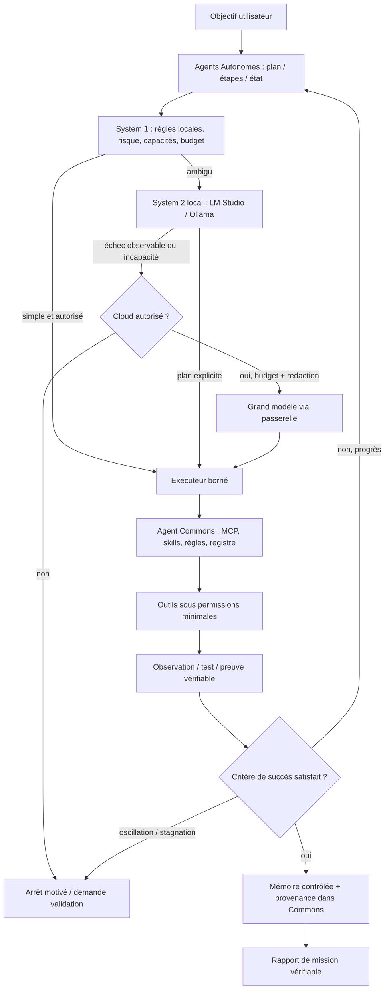

# Awesome Jev → Agent Commons / Agents Autonomes — sélection technique (2026-11-20)

> Évaluation à partir du catalogue [logicrw/awesome-jev-projects](https://github.com/logicrw/awesome-jev-projects), des README des projets et de leurs métadonnées GitHub au 20 novembre 2026. Les chiffres des README ne sont **pas** des mesures indépendantes. Aucun package ou service Jev n'est installé par ce document.

## Décision

**Ne pas installer Jev par défaut.** Privilégier des règles déterministes (latence nulle, coût nul), puis un petit modèle local dans LM Studio, puis un modèle local plus capable; le cloud reste un dernier recours **opt-in**, avec budget et contrôle de divulgation. Le catalogue recense des idées, pas une architecture validée.

**État réel d'Agent Commons, main `042a7ee` au début de l'étude :**
- Gestionnaire local de skills et MCP, synchronisation, installation pilotée, sécurité et retours arrière déjà présents ; Smart Skill Router hors ligne et limité en tokens déjà disponible.
- Prototype de missions dans `src/runtime/{mission,workspace,provider,cli}.ts` : étapes et outils bornés, empreintes anti-répétition, checkpoints, escalade facultative, preuve de lecture et de tests. Ce prototype ne fait **pas** encore l'orchestration multi-agent, la découverte MCP dynamique, la navigation desktop ni le benchmark sur RTX 5070 Ti.
- Le projet **Agents Autonomes** n'est pas disponible dans le checkout de cette analyse ; ne pas confondre le dépôt archivé `neosoda/SentinelAgent` avec l'orchestrateur actuel.
- L'architecture cible est : **Commons = capacités partagées**, **Autonomes = décision et exécution**. Le runtime expérimental dans Commons est à considérer comme composant à extraire lorsque le second dépôt sera accessible, sans régression de la CLI.

## Top 10 — opportunités classées par gain pragmatique

Légende : **C** = Agent Commons ; **A** = Agents Autonomes ; **adapt.** = adaptation de concept (pas de vendoring) ; **insp.** = inspiration seulement ; **plus tard** = expérimentation autonome, non nécessaire au MVP.

| # | Source (licence / dernière activité GitHub observée) | Valeur et destination | Dépendances / difficulté / priorité | Décision |
|---|---|---|---|---|
| 1 | [pi-warden](https://github.com/DevMortimer/pi-warden) (MIT, 20/11) | Garde avant écriture, règles de risque et preuves de fin ; C (politique) + A (application) | TypeScript / faible à moyenne / P0 | **adapt.** : règles déterministes d'abord, aucun appel Jev implicite |
| 2 | [winnow](https://github.com/GhalebDweikat/winnow) (MIT, 06/10) | Filtrer et rappeler sélectivement les grosses sorties d'outils ; C (contexte) | Python/Claude hooks/Jev / moyenne / P1 | **adapt.** : stockage local + rappel vérifiable, sans supprimer erreurs |
| 3 | [jev-pruner](https://github.com/tamaratran/jev-pruner) (MIT, 30/09) | Débruiter logs/build/test sans perdre erreurs ni artefacts ; C (résultats d'outils) | TypeScript/plugin/Jev / faible / P1 | **adapt.** : parser local déterministe avant juge IA |
| 4 | [jev-belay](https://github.com/valentynkit/jev-belay) (MIT, 09/10) | Vérifier une terminaison déclarée contre la preuve d'exécution ; A | Hooks Claude/Jev / faible / P0 | **insp.** : renforcer les preuves de mission déjà présentes ; **ne pas reprendre son fail-open** |
| 5 | [memsearch](https://github.com/zilliztech/memsearch) (MIT, 19/11) | Mémoire Markdown auditable, index reconstructible, récupération multi-clients ; C | Python/Milvus optionnel / moyenne / P1 | **adapt.** : conserver PostgreSQL/pgvector + provenance contrôlée |
| 6 | [LiteLLM](https://github.com/BerriAI/litellm) (licence GitHub NOASSERTION, 20/11) | Routage multi-fournisseurs, budgets et repli ; A via passerelle existante | Python, gateway réseau / moyenne / P1 | **plus tard** : vérifier la licence exacte des composants et ne pas dupliquer FreeLLMAPI/proxy existant |
| 7 | [agentgateway](https://github.com/agentgateway/agentgateway) (Apache-2.0, 20/11) | Politique MCP, authentification, audit, rate limiting ; C | Rust/service supplémentaire / forte / P2 | **plus tard** : utile uniquement si MCP distant ou multi-utilisateur |
| 8 | [Cua](https://github.com/trycua/cua) (MIT, 20/11) | Pilotes desktop, isolation, trajectoires et tests ; A | Pilote/VM/OS / forte / P2 | **plus tard** : pilote isolé, jamais contrôle Windows admin en direct |
| 9 | [Latitude](https://github.com/latitude-dev/latitude-llm) (MIT, 18/11) | Traces et jeu de régressions rejouables ; A | TS, télémétrie, services / moyenne-forte / P2 | **insp.** : commencer avec événements JSON locaux, pas la plateforme |
| 10 | [jev-ultrafast](https://github.com/browser-use/jev-ultrafast) (MIT, 11/11) | Séparer choix d'action browser, génération texte et exécution ; A | Python/Browser Harness/Jev / forte / P2 | **insp.** : préférer Playwright existant, sélectionner des actions autorisées |

**À écarter immédiatement :** ajouter un deuxième catalogue de skills ; réécrire le Smart Skill Router déjà livré avec [jev-skill-router](https://github.com/shimo4228/jev-skill-router) ; cacher aveuglément des logs (perte d'erreur) ; activer [GPTCache](https://github.com/zilliztech/GPTCache) sur des décisions sensibles (réponses périmées) ; dépendre du service Jev pour toutes les opérations.

## Architecture cible

**Frontière de confiance :** les sorties de fichiers, pages et outils sont des données non fiables ; aucune suggestion du LLM ne contourne les permissions. Cloud : pas de contenu privé sans consentement explicite. Les budgets doivent borner *temps, appels, tokens et modifications*, pas seulement un score de confiance déclaré.

## Quick wins et critères

1. **P0 — détecter les oscillations de fichiers** (prototype de cette branche) : empêcher qu'un agent réécrive une version antérieure d'un fichier après changement, même quand chaque écriture est marquée comme « progrès ». Conserver uniquement SHA-256 des chemins/versions en checkpoint ; 16 fichiers × 4 versions maximum. Test A→B→A, reprise checkpoint, éditions distinctes légitimes.
2. **P0 — preuves fortes de résultat** : pour chaque mission, imposer artefact, observation, test associé et preuve datée. Tests : faux `finish` impossible, test antérieur à dernière écriture invalide.
3. **P1 — débruitage sûr des sorties** : sorties longues conservées localement, erreurs et statuts jamais masqués, rappel borné sur demande ; comparer tokens réels et pertes d'information.
4. **P1 — mémoire avec provenance** : Markdown/source d'origine, séparation brouillon/vérifié, index pgvector régénérable ; tests de contamination, révocation et restauration.
5. **P1 — jeu de benchmarks local** : 20 objectifs reproductibles, LM Studio (petit modèle) versus local avancé puis cloud optionnel, mesures de réussite, boucles, temps, tokens réels, énergie GPU si observable. Ne pas sélectionner un modèle sur sa seule taille ni sur sa confiance auto-déclarée.

## Prototype, portée et retour arrière

- Branche : `feat/runtime-oscillation-guard-20261120`.
- Fichiers : `src/runtime/mission.ts`, `src/test/agent-runtime.test.ts`.
- Le garde ne touche **ni** MCP, **ni** skills, **ni** configuration utilisateur, **ni** réseau. Aucune librairie ajoutée.
- Il n'empêche pas toute forme de boucle : seules les réécritures d'un contenu récent sur un même chemin sont identifiées ; la limite globale d'étapes reste le filet de sécurité. Faux positif possible lorsqu'un vrai retour volontaire à une version précédente est demandé : arrêt conservateur voulu.
- Retour arrière : ne pas fusionner la PR ; ou annuler le commit sur cette branche. Les checkpoints plus anciens restent chargeables (`writeHistory` facultatif).

**Critères avant fusion :** `npm ci`, `npm run typecheck`, `npm test`, audit, packaging, 6 jobs CI (Windows/macOS/Linux × Node 22/24), Chromium et Windows portable sur le **SHA exact**. La recette RTX 5070 Ti/LM Studio sur machine réelle reste distincte et non validée ici.

## Trois différenciateurs à construire après la robustesse

1. **Action avec preuve intégrée** : tout appel d'outil déclare préconditions, empreinte d'état, risque, vérification postcondition et éventuel rollback.
2. **Routeur par coût d'incertitude vérifiable** : mesurer échecs, contradictions et nouveau travail réel pour décider « déterministe → petit modèle → gros modèle local → cloud », sans croire la confiance affichée.
3. **Mémoire à promotion explicable** : une expérience rejoint la mémoire commune uniquement avec artefact, date, domaine, conditions de validité et test de rappel ; les hypothèses non vérifiées expirent.

## Vérification et réserves

Les dates d'activité et licences de la table viennent des métadonnées GitHub observées au 20/11/2026, et non d'une exécution de ces dépôts. L'ensemble a été trié par pertinence au besoin local-first, poids des dépendances et redondance avec Agent Commons. Les mesures de latence et d'AUROC annoncées par certains auteurs restent **à reproduire**. Il ne faut pas interpréter « README lu / licence déclarée / repo récent » comme « produit audité ou sûr ». Ni fusion ni déploiement sans validation utilisateur.
